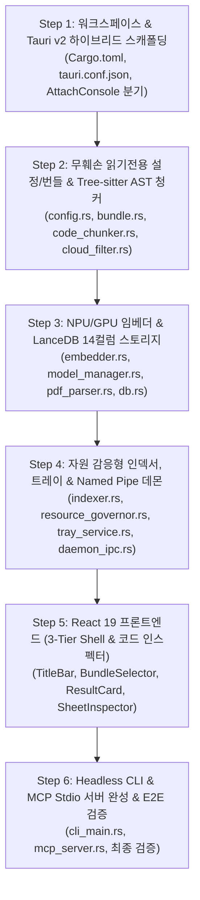

# 🛠️ [WORK ORDER & EXECUTION PLAN] eg2-rag 애플리케이션 작성 상세 작업계획서

* **문서명:** `RAG_EG2_앱작성_작업계획서.md`
* **버전:** v1.1.0 (색인 대상 원본 파일 절대 무훼손(Zero-Modification) 및 읽기 전용 불변성 엔지니어링 검증 명세 반영)
* **작성 일자:** 2026-10-26
* **기반 문서:** [`RAG_EmbeddingGemma2_기획서.md`](file:///c:/Users/azovl/OneDrive/Antigravity/Project/RAG_EmbeddingGemma2/RAG_EmbeddingGemma2_기획서.md) (v5.1.0), [`RAG_EG2_UI_UX_지침서.md`](file:///c:/Users/azovl/OneDrive/Antigravity/Project/RAG_EmbeddingGemma2/RAG_EG2_UI_UX_지침서.md) (v2.2.0)
* **프론트엔드 최우선 헌법:** `antigravity_ui_ux_architecture_rules.md`
* **기준 타겟 기기:** `AzovGBP` (Intel Core Ultra 7 155H, 32GB RAM, Intel Arc Graphics, **Intel AI Boost NPU**)
* **기준 타겟 OS:** **Windows 11 Home 26H2 (OS 빌드 26300.9711, x86_64-pc-windows-msvc)**
* **목적:** 기획서에 명시된 모든 기술 개선안(서브시스템 분기, Named Pipe IPC 데몬, Tree-sitter AST 청커, LanceDB 14컬럼 스키마 및 **원본 파일 절대 무훼손 보장**)을 누락 없이 구현하기 위한 엔지니어링 실행 로드맵 및 단계별 검증 명세를 제공한다.

---

## 1. 구현 실행 원칙 (Core Engineering Principles)

1. **원본 파일 절대 무훼손 헌법 (Zero-Modification Invariant):**
   * 색인 대상 원본 파일(OneDrive, iCloud, 로컬 코드 등)에 대해서는 **오직 공유 읽기 전용(`File::open` with `FILE_SHARE_READ | FILE_SHARE_WRITE | FILE_SHARE_DELETE`)**으로만 접근합니다.
   * 원본 파일의 내용, 속성, 타임스탬프(`mtime`/`ctime`) 수정이 시스템 전역에서 100% 금지되며, 대상 디렉토리 내부에는 어떠한 임시 파일(`.tmp`, `~lock`)도 생성하지 않습니다. 모든 DB와 캐시는 `{DATA_DIR}`(`C:\RAG_EG2`)에만 완전 격리 저장됩니다.
2. **단계별 완전성 (Phase Completeness):**
   * 코드를 즉흥적으로 흩뿌리지 않고, 아래 정의된 6단계(Step 1 ~ Step 6) 순서대로 작성하며 각 단계의 종료 검증 기준(Exit Criteria)을 만족한 후 다음 단계로 진입합니다.
3. **단일 바이너리 콘솔 & 서브시스템 무결성:**
   * `windows_subsystem = "windows"`를 유지하여 GUI 실행 시 검은색 CMD 창 팝업을 원천 차단하고, CLI/MCP 실행 시 Win32 `AttachConsole`을 통해 완벽한 터미널 입출력을 보장합니다.
4. **Named Pipe 기반 로컬 데몬 IPC (`\\.\pipe\eg2-rag-daemon`):**
   * 상주 중인 GUI 엔진에 CLI 및 `mcp-serve`의 쿼리를 위임함으로써 다중 프로세스 LanceDB 파일 락 충돌과 NPU 메모리 고갈을 100% 방지합니다.
5. **Tree-sitter AST 파싱 기반 구문 무결성:**
   * 소스코드(Python, C++, Rust)를 자를 때 정규식 대신 Tree-sitter AST를 사용하여 함수/클래스 경계와 정확한 라인 번호(`start_line`, `end_line`)를 도출합니다.
6. **UI/UX 헌법 엄격 준수:**
   * 프론트엔드는 React 19 + Tailwind CSS + `shadcn/ui` + `framer-motion` + `lucide-react`를 필수 조합하여 3-Tier App Shell 규격을 지킵니다.

---

## 2. 전체 구현 로드맵 (6-Step Overview)



---

## 3. 단계별 세부 작업 지시서 (Step-by-Step Execution Specs)

### 🔹 Step 1: 워크스페이스 및 Tauri v2 하이브리드 스캐폴딩 구축

* **목표:** 단일 바이너리 내에서 GUI 데스크톱과 Headless CLI를 안전하게 분기하는 기본 프로젝트 구조 및 빌드 인프라 구축.
* **작성 파일 목록:**
  * `Cargo.toml` (루트 워크스페이스)
  * `tauri.conf.json` (데스크톱 윈도우, 번들러 리소스 매핑)
  * `src-tauri/Cargo.toml` (Rust 의존성 정의)
  * `src-tauri/build.rs` (Tauri 빌드 스크립트)
  * `src-tauri/src/main.rs` (서브시스템 분기 및 `AttachConsole`)
  * `src-tauri/src/lib.rs` (Tauri 런타임 빌더 및 진입점)
* **세부 구현 지침:**
  1. `src-tauri/Cargo.toml` 의존성 구성:
     * `tauri = { version = "2.0", features = ["tray-icon"] }`
     * `tokio = { version = "1.40", features = ["full"] }`
     * `clap = { version = "4.5", features = ["derive"] }`
     * `serde = { version = "1.0", features = ["derive"] }`
     * `serde_json = "1.0"`, `toml = "0.8"`
     * `windows-sys = { version = "0.52", features = ["Win32_System_Console", "Win32_Storage_FileSystem"] }`
     * `lancedb = "0.12"`, `arrow-array = "53.0"`, `arrow-schema = "53.0"`
     * `ort = "2.0.0-rc.9"`, `tokenizers = "0.20"`
     * `tree-sitter = "0.22"`, `tree-sitter-python = "0.21"`, `tree-sitter-cpp = "0.22"`, `tree-sitter-rust = "0.21"`
     * `sysinfo = "0.31"`, `notify = "6.1"`, `walkdir = "2.5"`, `dunce = "1.0"`, `xxhash-rust = { version = "0.8", features = ["xxh3"] }`
     * `interprocess = "2.2"`, `pdfium-render = "0.8"`, `pdf-extract = "0.7"`
  2. `tauri.conf.json` 설정:
     * `app.windows[0]`: `title = "eg2-rag"`, `width = 1280`, `height = 840`, `minWidth = 960`, `minHeight = 640`, `decorations = false`, `transparent = true`.
     * `bundle.resources`: `["bin/pdfium.dll", "models/*"]`.
  3. `src-tauri/src/main.rs`:
     * `#![cfg_attr(not(debug_assertions), windows_subsystem = "windows")]` 선언.
     * 인자 검사:
       ```rust
       let args: Vec<String> = std::env::args().collect();
       if args.len() > 1 {
           if args[1] != "mcp-serve" {
               unsafe { windows_sys::Win32::System::Console::AttachConsole(windows_sys::Win32::System::Console::ATTACH_PARENT_PROCESS); }
           }
           cli::cli_main::run_cli(args);
       } else {
           eg2_rag_lib::run_gui();
       }
       ```
* **Step 1 완료 검증 기준 (Exit Criteria):**
  * `cargo check` 에러 0건.
  * 인자 없이 실행 시 Tauri GUI가 구동되고, 터미널에서 인자 전달 시 콘솔에 출력이 정상 연동되는지 확인.

---

### 🔹 Step 2: 무훼손 읽기전용 설정/번들 코어, 클라우드 가드 & Tree-sitter 코드 청커 구현

* **목표:** TOML 설정 관리, RAG 묶음 및 언어 프리셋 처리, Win32 MFT 구름 파일 차단, Tree-sitter AST 기반 코드 파서 및 `.ipynb` 파서 완성 (**원본 파일 무훼손 원칙 강제**).
* **작성 파일 목록:**
  * `src-tauri/src/core/config.rs`
  * `src-tauri/src/core/bundle.rs`
  * `src-tauri/src/core/cloud_filter.rs`
  * `src-tauri/src/core/code_chunker.rs`
  * `src-tauri/src/core/extractor.rs`
* **세부 구현 지침:**
  1. **무훼손 원칙 강제 (`code_chunker.rs`, `extractor.rs`):**
     * 모든 대상 파일 읽기는 `std::fs::File::open()` (또는 `tokio::fs::read_to_string()`)으로만 수행.
     * `OpenOptions`의 쓰기/생성/잘라내기 옵션 절대 사용 금지.
     * 대상 디렉토리에 어떠한 임시 파일도 생성하지 않음.
  2. `config.rs`:
     * `EG2_RAG_HOME` 환경변수 또는 기본 `C:\RAG_EG2` 해석 로직 구현.
     * `config.toml` 자동 생성 및 역직렬화/직렬화 구현.
     * 번들 추가 시 경로가 기존 `target_paths`에 속하지 않으면 `target_paths`에 자동 편입하고 플래그 반환.
  3. `bundle.rs`:
     * 언어 프리셋 매핑 테이블 구현 (`python`, `cpp`, `rust`, `code_all`, `markdown`, `pdf`, `custom`).
     * `to_sql_filter(&self) -> String` 구현:
       * 모든 경로는 소문자 슬래시(`/`)로 변환하여 `file_path LIKE 'c:/users/...'` 절 생성.
       * 확장자는 `ext IN ('py', 'ipynb')` 절 결합.
  4. `cloud_filter.rs`:
     * `is_cloud_placeholder(path: &Path) -> bool` 구현:
       * NTFS MFT 비트마스크 검사 (`0x00400000`, `0x00040000`, `0x00001000`).
       * 구름 파일 감지 시 파일 오픈 없이 `true`를 반환하여 다운로드 방지.
  5. `code_chunker.rs`:
     * Tree-sitter 파서 3종 초기화 (`tree_sitter_python::language()`, `tree_sitter_cpp::language()`, `tree_sitter_rust::language()`).
     * AST 탐색을 통해 함수/클래스 노드(`function_definition`, `class_definition`, `struct_specifier`, `impl_item`)의 시작/종료 라인과 함수 시그니처(`symbol`) 추출.
     * `.ipynb` 파일: `serde_json`으로 파싱하여 `cells` 중 `code` 및 `markdown` 셀의 `source`만 추출하고 `outputs`/Base64 이미지는 배제.
  6. `extractor.rs`:
     * 일반 마크다운/텍스트 파일의 문단 및 1,000자 단위 슬라이딩 윈도우 청킹 (`start_line`, `end_line` 계산).
* **Step 2 완료 검증 기준 (Exit Criteria):**
  * 단위 테스트 검증: 대상 파일을 읽은 후 파일의 수정 시각(`mtime`)이 1밀리초도 변하지 않았는지 확인.
  * 대상 폴더 내에 `.tmp` 파일이 단 1개도 생성되지 않았는지 확인.
  * Python(`def`, `class`), C++(`class`, `void func()`), Rust(`pub fn`) 샘플 코드에서 `symbol`, `start_line`, `end_line`이 정확히 분리되는지 검증.

---

### 🔹 Step 3: NPU/GPU 임베더, PDFium 파서 및 LanceDB 14컬럼 스토리지 구축

* **목표:** EmbeddingGemma 2 MRL 256차원 임베딩 파이프라인, 한국어 PDFium 파서 및 LanceDB 14컬럼 테이블 연동 완성 (데이터베이스는 `{DATA_DIR}` 전용 폴더에 완전 격리 저장).
* **작성 파일 목록:**
  * `src-tauri/src/core/model_manager.rs`
  * `src-tauri/src/core/embedder.rs`
  * `src-tauri/src/core/pdf_parser.rs`
  * `src-tauri/src/core/db.rs`
* **세부 구현 지침:**
  1. `model_manager.rs`:
     * `{DATA_DIR}/models` 내 `model.onnx` 및 `tokenizer.json` 존재 확인 및 SHA-256 검증.
     * 원격 비동기 다운로드 스트림(`reqwest`) 구현 및 진행률 콜백 지원.
  2. `embedder.rs`:
     * `ort` 세션 빌더: DirectML NPU (`device_id`) $\rightarrow$ DirectML Arc GPU $\rightarrow$ CPU 순차 폴백.
     * 입력 텍스트 포맷: `// [File: {file_name} | Symbol: {symbol}]\n{content}`
     * Mean Pooling $\rightarrow$ 상위 256차원 MRL 슬라이싱 $\rightarrow$ L2 정규화(`norm = sqrt(sum(x^2))`, `x / norm`).
     * 개발 편의를 위한 결정론적 Mock 임베더(`mock_embed()`) 내장.
  3. `pdf_parser.rs`:
     * PDF 파일 역시 `File::open` 읽기 전용으로만 로드.
     * `pdfium-render`를 통해 HWP 변환본 한국어 CMap(Identity-H) 및 표 좌표를 마크다운 테이블로 복원.
     * DLL 로드 불가 시 `pdf-extract` 자동 폴백.
  4. `db.rs`:
     * LanceDB 연결 및 `chunks` 테이블을 `{DATA_DIR}\lancedb`에 14개 고정 Arrow Schema로 생성:
       `[id, file_path, display_path, file_name, ext, lang, symbol, start_line, end_line, chunk_index, content, file_hash, mtime, vector]`
     * `search_bundle(query_vector, bundle_filter, top_k)`: LanceDB Vector Search + Arrow 비트맵 필터링.
     * `get_file_context(display_path, start_line, end_line, padding)`: 원본 파일(읽기 전용)에서 상하 맥락 라인 발췌.
     * `get_similar_files(display_path, top_k)`: 해당 파일의 평균 임베딩 벡터로 연관 문서 검색.
* **Step 3 완료 검증 기준 (Exit Criteria):**
  * `{DATA_DIR}\lancedb` 외의 위치에는 DB 파일이 일절 생성되지 않는지 확인.
  * 더미 청크 10개를 14컬럼 스키마로 삽입 후, 번들 필터 시맨틱 쿼리가 10ms 이내에 올바른 메타데이터를 반환하는지 테스트.

---

### 🔹 Step 4: 자원 감응형 인덱서, 트레이 서비스 & Named Pipe 데몬 구축

* **목표:** 백그라운드 색인 및 자원 거버너, 트레이 아이콘 상주, 프로세스 간 동시성 해결용 Named Pipe 서버/클라이언트 및 Tauri IPC 커맨드 등록.
* **작성 파일 목록:**
  * `src-tauri/src/core/resource_governor.rs`
  * `src-tauri/src/core/indexer.rs`
  * `src-tauri/src/core/tray_service.rs`
  * `src-tauri/src/core/daemon_ipc.rs`
  * `src-tauri/src/commands/search_cmd.rs`
  * `src-tauri/src/commands/bundle_cmd.rs`
  * `src-tauri/src/commands/config_cmd.rs`
  * `src-tauri/src/commands/system_cmd.rs`
  * `src-tauri/src/commands/index_cmd.rs`
* **세부 구현 지침:**
  1. `resource_governor.rs`:
     * `sysinfo`를 통해 1초마다 CPU/RAM 모니터링 $\rightarrow$ `CPU > 65%` 또는 `RAM > 80%` 감지 시 인덱서 일시정지 신호 전송.
  2. `indexer.rs`:
     * `walkdir` 초기 순회: `cloud_filter.rs` 검사 후 `xxh3(content)`와 DB의 `file_hash`를 비교하여 변경된 파일만 증분 색인.
     * **물리적 파일 삭제 방지:** `notify`가 파일 삭제 이벤트를 전달할 때, 오직 **LanceDB 내부의 레코드만 삭제(`delete_by_file_path`)**하며 파일 시스템의 파일 삭제 API는 절대 호출하지 않음.
  3. `daemon_ipc.rs`:
     * Named Pipe `\\.\pipe\eg2-rag-daemon` 서버 스레드 구동.
     * 요청 수신: `{ "cmd": "search", "query": "...", "bundle_id": "...", "top_k": 5 }`
     * 상주 중인 LanceDB/NPU 엔진으로 즉시 쿼리하여 JSON 응답 반환.
  4. `tray_service.rs`:
     * 윈도우 11 알림 영역 트레이 아이콘 등록, 실시간 툴팁(진행률/상태), 우클릭 메뉴 구현.
     * 창 닫기(`CloseRequested`) 시 프로세스를 종료하지 않고 `window.hide()` 처리.
  5. `commands/*.rs`:
     * `search_bundle`, `get_file_context`, `get_similar_files`
     * `get_bundles`, `save_bundle`, `delete_bundle`
     * `get_config`, `save_config`, `detect_cloud_drives`
     * `get_system_metrics`, `open_in_vscode`, `open_in_explorer`
     * `start_indexing`, `pause_indexing`, `get_index_stats`
     * `src-tauri/src/lib.rs`의 `tauri::generate_handler![]`에 누락 없이 등록.
* **Step 4 완료 검증 기준 (Exit Criteria):**
  * 색인 도중 타 프로그램(메모장/VS Code)에서 해당 파일을 수정/저장할 때 파일 잠금 에러가 발생하지 않는지 검증.
  * Named Pipe 클라이언트로 쿼리 전송 시 정상 응답 수신 확인.
  * 창 닫기 시 트레이로 정상 숨김 처리되고 트레이 더블클릭 시 복원되는지 확인.

---

### 🔹 Step 5: React 19 프론트엔드 구축 (Strict 3-Tier App Shell & Code Inspector)

* **목표:** `RAG_EG2_UI_UX_지침서.md` 및 `antigravity_ui_ux_architecture_rules.md`를 100% 준수하는 데스크톱 GUI 구현.
* **작성 파일 목록:**
  * `src-ui/src/lib/tauri-bridge.ts` (모든 IPC 커맨드/이벤트 매핑)
  * `src-ui/src/components/layout/TitleBar.tsx` (Mica 프레임리스 커스텀 타이틀바, 무훼손 안전 뱃지)
  * `src-ui/src/components/layout/Sidebar.tsx` (240px $\leftrightarrow$ 64px 접이식 사이드바)
  * `src-ui/src/components/layout/Header.tsx` (Breadcrumb, BundleSelector, 테마 토글)
  * `src-ui/src/components/bundles/BundleSelector.tsx` (언어 뱃지 일체형 검색창 셀렉터)
  * `src-ui/src/components/bundles/BundleModal.tsx` (언어 프리셋 칩 7종)
  * `src-ui/src/components/bundles/CollectionsView.tsx` (번들 Bento Grid 대시보드)
  * `src-ui/src/components/search/HeroSearch.tsx`, `BentoGrid.tsx`, `ResultCard.tsx` (라인 번호, VS Code 점프)
  * `src-ui/src/components/inspector/SheetInspector.tsx`, `TableViewer.tsx`, `SimilarFiles.tsx`
  * `src-ui/src/components/basket/KnowledgeCart.tsx` (플로팅 지식 바구니)
  * `src-ui/src/components/onboarding/WizardModal.tsx` (4단계 시각 온보딩 마법사)
* **세부 구현 지침:**
  1. `TitleBar.tsx`:
     * `h-9` 높이, `data-tauri-drag-region`, NPU 상태 녹색 점 및 툴팁, 🛡️ **"원본 무훼손 읽기전용" 안전 뱃지**, 최소화/최대화/닫기(트레이 숨김).
  2. `BundleModal.tsx`:
     * 언어 프리셋 칩: `[🐍 Python 전용]`, `[⚙️ C/C++ 전용]`, `[🦀 Rust 전용]`, `[💻 프로그래밍 코드 전체]`, `[📝 마크다운 메모]`, `[📄 PDF 문서]`, `[✏️ 직접 입력]`.
     * 클릭 시 해당 확장자 배열 자동 설정 및 네이티브 폴더 브라우저 다이얼로그 호출.
  3. `ResultCard.tsx`:
     * 파일명, 함수/클래스 심볼 뱃지, 코사인 유사도 점수 뱃지, 라인 번호(`L142-168`), 신택스 하이라이팅 코드 스니펫.
     * 액션 버튼: `[🔍 원문 인스펙터]`, `[💻 VS Code로 열기]`, `[📋 코드 복사]`, `[📂 파일 위치 열기]`, `[⭐ 바구니 담기]`.
  4. `SheetInspector.tsx`:
     * 우측 슬라이드인 Drawer.
     * 검색된 코드 영역 하이라이트 및 `[⬆ 위쪽 코드 더보기]` / `[⬇ 아래쪽 코드 더보기]` 클릭 시 `get_file_context` IPC 호출로 실시간 맥락 확장.
     * 하단에 `SimilarFiles.tsx`(연관 코드 파일 Top 5) 표시.
* **Step 5 완료 검증 기준 (Exit Criteria):**
  * `pnpm build` 또는 `npm run build` 시 TypeScript 에러 0건 및 린트 경고 0건.
  * 브라우저 개발자 도구 콘솔에 런타임 에러나 React Warning이 발생하지 않는지 확인.

---

### 🔹 Step 6: Headless CLI & MCP Stdio 서버 완성 및 E2E 최종 검증

* **목표:** 터미널 CLI 서브커맨드와 외부 AI 에이전트(Claude Desktop, Cursor)용 MCP 서버 완성 및 전 기능 엔드투엔드 검증.
* **작성 파일 목록:**
  * `src-tauri/src/cli/cli_main.rs`
  * `src-tauri/src/cli/mcp_server.rs`
* **세부 구현 지침:**
  1. `cli_main.rs`:
     * `eg2-rag search <QUERY> [--bundle <ID>] [--top-k <N>]`
     * `eg2-rag bundle list`
     * `eg2-rag bundle add --name <NAME> --paths <PATHS...> --preset <PRESET>`
     * `eg2-rag index [--path <PATH>]`
     * `eg2-rag mcp-serve`
     * Named Pipe 클라이언트로 상주 데몬에 질의 위임 (데몬 미실행 시에만 직접 LanceDB 로드).
  2. `mcp_server.rs`:
     * MCP JSON-RPC 2.0 Stdio 프로토콜 핸들러 구현.
     * Tools 등록:
       * `semantic_search`: `{ query: string, bundle_id?: string, top_k?: number }`
       * `list_bundles`: 등록된 RAG 묶음 목록 반환.
       * `get_code_context`: `{ file_path: string, start_line: number, end_line: number }`
* **Step 6 최종 완료 검증 체크리스트 (Verification Checklist):**
  * [ ] **원본 파일 무훼손 검증:** 전체 색인 및 검색을 완료한 후, 색인 대상 파일들의 해시(SHA-256)와 수정 시각(`mtime`)이 실행 전과 100% 동일한가?
  * [ ] **임시 파일 미생성 검증:** 색인 대상 폴더 내에 `.tmp`, `~lock`, `.index` 등 프로그램이 생성한 파일이 단 1개도 없는가?
  * [ ] **동시 편집 허용 검증:** 색인 진행 중에 대상 파일을 VS Code나 메모장으로 열어 수정하고 저장할 때 파일 락 에러가 발생하지 않는가?
  * [ ] **GUI 단독 자립성:** 온보딩 마법사만으로 저장소 위치, 클라우드 선택, NPU 설정이 터미널 없이 완료되는가?
  * [ ] **언어별 번들 필터링:** `[🐍 Python 전용]` 묶음 생성 후 질의 시 C++이나 마크다운이 배제되고 Python 함수만 정확히 검색되는가?
  * [ ] **VS Code 연동:** 코드 결과 카드에서 `[💻 VS Code로 열기]` 클릭 시 지정 라인 번호(`path:142`)로 VS Code가 즉시 열리는가?
  * [ ] **인스펙터 상하 확장:** 우측 인스펙터에서 `[⬆ 위쪽 코드 더보기]` 클릭 시 원본 코드의 상단 라인이 자연스럽게 확장되는가?
  * [ ] **구름 파일 스킵:** OneDrive/iCloud의 구름 아이콘(미다운로드) 파일 접근 시 다운로드가 유발되지 않고 100% 스킵되는가?
  * [ ] **트레이 숨김:** 창 닫기(`X`) 클릭 시 트레이로 숨겨지고 백그라운드 색인이 정상 유지되는가?
  * [ ] **CLI 콘솔 출력:** 터미널에서 `eg2-rag search "..."` 실행 시 부모 콘솔에 결과가 즉시 출력되는가?
  * [ ] **MCP 무결성:** `eg2-rag mcp-serve` 실행 시 콘솔 창 팝업 없이 표준 입출력으로 순수 JSON-RPC 메시지만 오가는가?

---

## 4. 관련 파일 링크

* [프로덕션 상세 기획서 (v5.1.0)](file:///c:/Users/azovl/OneDrive/Antigravity/Project/RAG_EmbeddingGemma2/RAG_EmbeddingGemma2_기획서.md)
* [UI/UX 설계 지침서 (v2.2.0)](file:///c:/Users/azovl/OneDrive/Antigravity/Project/RAG_EmbeddingGemma2/RAG_EG2_UI_UX_지침서.md)
* [Antigravity UI/UX Architecture Rules](file:///c:/Users/azovl/OneDrive/Antigravity/Project/antigravity_ui_ux_architecture_rules.md)