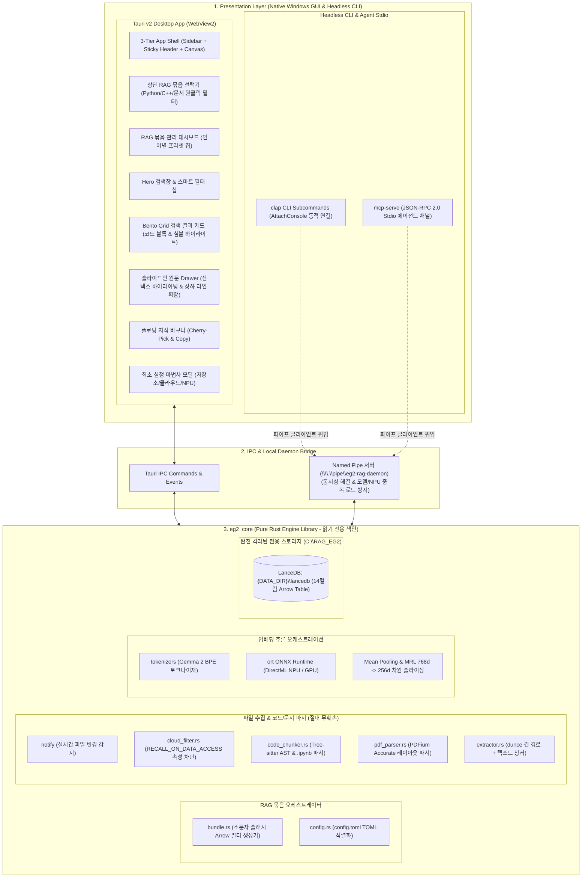

# 🦀 [PROJECT SPEC] eg2-rag: Rust + Tauri v2 + EmbeddingGemma 2 기반 로컬 클라우드 고속 검색 엔진 및 MCP 에이전트 프로덕션 상세 기획서

* **프로젝트명:** `eg2-rag` (`RAG_EmbeddingGemma2`)
* **문서 버전:** v5.1.0 (색인 대상 원본 파일 절대 무훼손(Zero-Modification) 및 읽기 전용 불변성 헌법 반영)
* **작성 일자:** 2026-10-26
* **기준 타겟 기기:** `AzovGBP` (Intel Core Ultra 7 155H, 32GB RAM, Intel Arc Graphics, **Intel AI Boost NPU**)
* **기준 타겟 OS:** **Windows 11 Home 26H2 (OS 빌드 26300.9711, x86_64-pc-windows-msvc)**
* **핵심 언어/아키텍처:**
  * **코어 엔진:** Pure Rust (Edition 2021, 비동기 런타임 `tokio`), 외부 Python 런타임 의존성 0%
  * **데스크톱 GUI 앱 프레임워크:** **Tauri v2** (Windows 11 네이티브 WebView2 바인딩, 경량/고성능 단일 실행 파일 배포)
  * **프론트엔드 UI 스택:** React 19 + Vite + TypeScript + Tailwind CSS + `shadcn/ui` + `framer-motion` + `lucide-react`
* **최우선 안전 헌법 (Non-Negotiable Safety Invariant):**
  * **"색인 대상 원본 파일 100% 무훼손 및 읽기 전용 불변성 보장 (Zero-Modification & Read-Only Guarantee)"**
  * 사용자의 모든 대상 파일(클라우드 동기화 문서, 소스코드, 노트 등)은 오직 **공유 읽기 전용(Shared Read-Only)**으로만 접근되며, 어떠한 경우에도 파일의 내용, 타임스탬프, 속성을 수정하거나 임시 파일을 생성하지 않음.
* **실행 모드 원칙:**
  * **기본 실행:** 더블클릭 또는 인자 없는 실행 시 콘솔 창 없이 **모던 데스크톱 GUI 창** 즉시 실행
  * **설치/운용 자립성:** **최초 환경 설정, 모델 다운로드, 폴더 지정, 프로그래밍 언어별 RAG 묶음 구성, 시맨틱 검색, 원문 열람 등 모든 기능을 터미널 없이 100% GUI만으로 완료 가능**
  * **CLI & 에이전트 모드:** 터미널에서 서브커맨드(`search`, `index`, `bundle`, `mcp-serve`) 입력 시 Win32 `AttachConsole` 및 Named Pipe IPC를 통해 헤드리스(Headless) 고속 실행
* **기본 데이터 저장소 경로 (사용자 변경 가능):**
  * 기본 베이스 디렉토리: `C:\RAG_EG2` (환경변수 `EG2_RAG_HOME` 또는 GUI 설정 화면/CLI `--data-dir`로 자유 변경)
  * LanceDB 데이터베이스: `{DATA_DIR}\lancedb`
  * 모델 및 토크나이저 캐시: `{DATA_DIR}\models`
  * 사용자 설정 파일: `{DATA_DIR}\config.toml`
* **연계 표준 문서:**
  * 앱작성 작업계획서: [`RAG_EG2_앱작성_작업계획서.md`](file:///c:/Users/azovl/OneDrive/Antigravity/Project/RAG_EmbeddingGemma2/RAG_EG2_앱작성_작업계획서.md)
  * UI/UX 설계 및 데스크톱 창 규격 지침: [`RAG_EG2_UI_UX_지침서.md`](file:///c:/Users/azovl/OneDrive/Antigravity/Project/RAG_EmbeddingGemma2/RAG_EG2_UI_UX_지침서.md)
  * 프론트엔드 최우선 헌법: `antigravity_ui_ux_architecture_rules.md`

---

## 1. 기술 검증 기반 아키텍처 핵심 개선 사항

기존 기획서의 잠재적 구현 결함을 선제적으로 해결한 프로덕션 아키텍처 사양입니다:

### 1.1. Windows 서브시스템 & 단일 바이너리 입출력 분기 (`AttachConsole`)
* **문제 해결:** `windows_subsystem = "windows"`로 빌드하여 GUI 실행 시 검은색 콘솔 창을 100% 숨깁니다.
* **CLI/MCP 입출력 복원:** `main.rs` 진입 시 CLI 인자가 주어지면:
  * 일반 서브커맨드(`search`, `bundle`, `index` 등)일 경우 Win32 `AttachConsole(ATTACH_PARENT_PROCESS)`를 호출하여 호출한 PowerShell/CMD 터미널에 `stdout`/`stderr`를 동적 연결합니다.
  * `mcp-serve`의 경우 부모 프로세스(Claude Desktop, Cursor 등)가 파이프(`stdin`/`stdout`)를 직접 연결하므로 콘솔 창 팝업 없이 표준 스트림을 유지합니다.

### 1.2. Named Pipe 기반 로컬 데몬-클라이언트 아키텍처 (`\\.\pipe\eg2-rag-daemon`)
* **LanceDB 동시성 락 & NPU 자원 충돌 원천 차단:**
  * GUI 트레이 앱이 실행되면 로컬 Named Pipe 서버를 오픈합니다.
  * CLI(`eg2-rag search ...`)나 AI 에이전트(`mcp-serve`)가 호출되면 프로세스마다 무거운 LanceDB와 ONNX/NPU를 중복 로드하지 않고, Named Pipe를 통해 상주 중인 GUI 엔진에 JSON-RPC로 질의를 위임합니다.
  * **결과:** 0ms 쿼리 응답, 프로세스 간 LanceDB 파일 락 충돌 0%, NPU 메모리 고갈 원천 방지. (GUI 미실행 시에만 CLI 프로세스가 단독 Read-Only 모드로 직접 로드).

### 1.3. LanceDB Apache Arrow 14컬럼 확정 스키마
UI/UX 지침서의 "정확한 코드 라인 번호(`L142-168`) 표시", "VS Code 점프(`code -g`)", "인스펙터 상/하 맥락 실시간 확장"을 지원하기 위해 14개 필수 컬럼을 고정합니다:

| 필드명 | Arrow 데이터 타입 | 설명 및 용도 |
| :--- | :--- | :--- |
| `id` | `Utf8` | `xxh3(normalized_path + chunk_index)` 고유 ID |
| `file_path` | `Utf8` | **소문자 및 슬래시(`/`)로 정규화된 절대 경로** (예: `c:/users/azovl/project/main.py`) |
| `display_path` | `Utf8` | UI 표시 및 탐색기/에디터 연동용 원본 윈도우 경로 (예: `C:\Users\azovl\Project\main.py`) |
| `file_name` | `Utf8` | 파일명 (예: `main.py`) |
| `ext` | `Utf8` | 점(`.`) 제외 소문자 확장자 (예: `py`, `cpp`, `rs`) |
| `lang` | `Utf8` | 언어 식별자 (`python`, `cpp`, `rust`, `markdown`, `pdf`, `text`) |
| `symbol` | `Utf8` | 추출된 함수/클래스 시그니처 (예: `def backward_pass()`, 없으면 `""`) |
| `start_line` | `UInt32` | 청크 시작 라인 번호 (1-based, PDF는 페이지 번호) |
| `end_line` | `UInt32` | 청크 종료 라인 번호 |
| `chunk_index` | `UInt32` | 동일 파일 내 청크 순번 (인스펙터 상/하 맥락 조회용) |
| `content` | `Utf8` | 화면 표시 및 코드 복사용 **순수 원문 코드/텍스트** |
| `file_hash` | `Utf8` | 파일 전체 `xxh3` 해시 (증분 색인 변경 감지용) |
| `mtime` | `Int64` | 파일 수정 타임스탬프 (Unix Epoch seconds) |
| `vector` | `FixedSizeList(Float32, 256)` | L2 정규화된 256차원 EmbeddingGemma 2 MRL 벡터 |

* **임베딩 입력 텍스트와 저장 텍스트의 분리:**
  * 임베딩 추론 입력: `// [File: {file_name} | Symbol: {symbol}]\n{content}` (검색 정확도 극대화)
  * DB `content` 컬럼: 메타데이터 없는 순수 코드 본문 (복사 시 오염 방지)

### 1.4. `tree-sitter` AST 구문 파서 & Jupyter Notebook (`.ipynb`) 파서
* **정규식 한계 극복:** `tree-sitter`, `tree-sitter-python`, `tree-sitter-cpp`, `tree-sitter-rust`를 도입하여 복잡한 매크로, 템플릿, 중괄호 블록 내에서도 100% 정확한 AST 기반 함수/클래스 경계와 라인 번호를 추출.
* **Jupyter Notebook (`.ipynb`) 전용 파서:** JSON 문서 파싱을 통해 `cell_type == "code"` 또는 `"markdown"` 셀의 순수 소스만 추출하고, Base64 이미지 및 실행 결과(`outputs`)는 원천 폐기하여 벡터 오염 차단.

### 1.5. 번들(Bundle) 미색인 경로 자동 등록 & 경로 정규화
* 사용자가 새 RAG 묶음 등록 시 기존 색인 경로(`target_paths`) 외의 새 폴더를 선택하면, 시스템이 이를 자동으로 `target_paths`에 등록하고 백그라운드 증분 색인을 자동 개시하여 검색 결과 0건 현상을 방지.
* 모든 경로는 소문자 슬래시(`c:/path/...`)로 정규화하여 Windows 대소문자 및 역슬래시 이스케이프 오류를 방지.

### 1.6. VS Code 및 탐색기 호출 안정성 강화
* Windows 환경에서 `code -g` 호출 시 `cmd.exe /C code -g "{display_path}:{start_line}"`를 비동기로 호출하며, 실패 시 `%LOCALAPPDATA%\Programs\Microsoft VS Code\Code.exe` 절대 경로를 찾아 자동 폴백.
* 탐색기 선택 열기: `explorer.exe /select,"{display_path}"`.

---

## 2. 색인 대상 원본 파일 절대 무훼손 및 읽기 전용 보안 불변성 (Zero-Modification Guarantee)

사용자의 소중한 원본 문서, 소스코드, 클라우드 동기화 파일이 색인 과정에서 1바이트라도 손상되거나 변형되는 것을 방지하기 위해 다음 **7대 무훼손 보안 규칙**을 시스템 아키텍처에 강제합니다:

```mermaid
flowchart TD
    subgraph USER_STORAGE["사용자 원본 파일 영역 (OneDrive / iCloud / 로컬 코드)"]
        ORIG_FILE["원본 파일 (규정집.pdf, model.py, note.md)"]
    end

    subgraph READ_GATEWAY["1. 공유 읽기 전용 게이트웨이 (Read-Only Gateway)"]
        RO_OPEN["std::fs::File::open (GENERIC_READ 단독)"]
        SHARE_LOCK["FILE_SHARE_READ | FILE_SHARE_WRITE | FILE_SHARE_DELETE\n(타 프로그램 동시 편집 100% 허용)"]
        NO_MTIME["타임스탬프(mtime/ctime) 및 파일 속성 불변 보장"]
    end

    subgraph SYSTEM_ISOLATION["2. 시스템 저장소 완전 물리 격리 (C:\\RAG_EG2)"]
        LANCE_DB[("LanceDB 벡터 데이터베이스")]
        MODEL_STORE["Gemma 2 ONNX 모델 및 캐시"]
        CONF_FILE["config.toml 설정 파일"]
    end

    ORIG_FILE -->|오직 읽기(Read) 스트림만 연결| RO_OPEN
    RO_OPEN --> SHARE_LOCK
    SHARE_LOCK --> NO_MTIME
    NO_MTIME -->|추출된 텍스트/벡터만 전달| LANCE_DB
    
    ORIG_FILE -.->|쓰기/수정/삭제/임시파일 생성 100% 원천 차단| X["❌ 쓰기 시도 차단"]
```

### 2.1. 7대 무훼손 보안 원칙
1. **오직 읽기 전용 핸들 오픈 (`File::open` 강제):**
   * 색인 엔진 내 모든 원본 파일 접근은 `std::fs::File::open()` (또는 `tokio::fs::File::open()`) 단독으로만 수행됩니다.
   * `OpenOptions::new().write(true)`, `.create(true)`, `.truncate(true)`, `.append(true)` 등 파일 내용을 수정할 수 있는 모든 플래그는 색인 대상 파일에 대해 시스템 전역에서 100% 금지됩니다.
2. **동시성 공유 모드 허용 (`FILE_SHARE_READ | FILE_SHARE_WRITE | FILE_SHARE_DELETE`):**
   * `eg2-rag`가 색인을 위해 파일을 읽는 중에도 사용자가 Visual Studio Code, MS Word, 메모장, 한글(HWP) 등으로 해당 파일을 자유롭게 수정하거나 저장할 수 있도록 **완전 공유 잠금(Shared Lock)**으로만 접근합니다.
   * "다른 프로세스가 사용 중이므로 파일을 열 수 없습니다"와 같은 락 충돌이나 사용자 작업 방해가 발생하지 않습니다.
3. **타임스탬프 및 메타데이터 100% 보존:**
   * 파일의 수정 시각(`mtime`), 생성 시각(`ctime`), 접근 시각(`atime`) 및 NTFS 속성을 일절 변경하지 않습니다.
4. **색인 대상 디렉토리 내 임시 파일 생성 원천 금지:**
   * 사용자의 대상 폴더(OneDrive, iCloud, 로컬 작업 디렉토리 등) 내부에는 어떠한 임시 파일(`.tmp`, `~lock`, `.index`, `.cache` 등)도 절대 생성하지 않습니다.
   * 모든 벡터 DB(`lancedb`), 인덱스 캐시, 해시 테이블, 모델 가중치는 사용자가 지정한 전용 시스템 디렉토리(`C:\RAG_EG2` / `{DATA_DIR}`) 내부에만 완전 격리 저장됩니다.
5. **클라우드 동기화 폭풍(Sync Storm) 원천 방지:**
   * 원본 파일의 수정이나 타임스탬프 변경이 0건이므로, OneDrive, iCloud Drive, Dropbox, Google Drive의 동기화 감시 엔진이 불필요한 업로드/다운로드 루프나 파일 충돌 사본(Conflict Copy)을 발생시키지 않습니다.
6. **물리적 파일 삭제/이동 불가 원칙:**
   * 감시 데몬(`notify`)이 사용자에 의한 원본 파일의 삭제를 감지했을 때 수행하는 유일한 작업은 **LanceDB 내부의 인덱스 레코드 삭제**뿐입니다.
   * `eg2-rag` 엔진 내부에는 사용자의 하드 디스크 상에 있는 실제 대상 파일을 삭제하거나 이동하는 API(`std::fs::remove_file` 등) 호출이 전혀 존재하지 않습니다.
7. **오류/잠금 파일 안전 스킵 (Graceful Skip):**
   * 다른 프로그램에 의해 배타적(Exclusive)으로 잠겨 있거나 권한이 부족한 파일을 발견할 경우, 강제로 잠금을 풀거나 파일을 수정하려 하지 않고 안전하게 스킵(Skip)하며 경고 로그만 남깁니다.

---

## 3. RAG 지식 묶음(Collections) 및 분류 체계 사양

### 3.1. 프리셋 및 언어별 필터링 규칙

| RAG 묶음 유형 | 프리셋 키 | 대상 확장자 목록 (`extensions`) | 대표 유스케이스 |
| :--- | :--- | :--- | :--- |
| **🐍 Python 코드 전용** | `python` | `["py", "ipynb", "pyi"]` | 머신러닝 파이프라인, 데이터 분석 스크립트, FastAPI 백엔드 코드 탐색 |
| **⚙️ C/C++ 코드 전용** | `cpp` | `["cpp", "hpp", "c", "h", "cc", "cxx"]` | 임베디드 펌웨어, 고성능 게임/그래픽 엔진, 네이티브 알고리즘 라이브러리 |
| **🦀 Rust 코드 전용** | `rust` | `["rs"]` | 시스템 프로그래밍, 비동기 서버, Tauri 백엔드 엔진 코드베이스 |
| **💻 프로그래밍 코드 전체**| `code_all` | `["py", "ipynb", "cpp", "hpp", "c", "h", "rs", "ts", "js", "go", "java", "cs"]` | 특정 프로젝트 디렉토리 내의 모든 언어 소스코드 통합 참조 |
| **📝 마크다운 메모 전용** | `markdown`| `["md", "markdown"]` | 옵시디언/노션 마크다운 지식 베이스, 기술 기획 문서 |
| **📄 PDF 문서 전용** | `pdf` | `["pdf"]` | 사내 업무 규정집, 학술 논문, 특허 명세서, 제품 매뉴얼 |
| **✏️ 사용자 정의 (Custom)** | `custom` | 사용자 직접 입력 (예: `["toml", "yaml", "json"]`) | 설정 파일, 인프라 코드(IaC), 커스텀 데이터 파일 |

---

### 3.2. 설정 파일 스키마 (`config.toml`)

```toml
[storage]
base_dir = "C:\\RAG_EG2"
lancedb_dir = "C:\\RAG_EG2\\lancedb"
models_dir = "C:\\RAG_EG2\\models"

[indexing]
target_paths = [
    { name = "OneDrive", path = "C:\\Users\\azovl\\OneDrive", enabled = true },
    { name = "iCloud", path = "C:\\Users\\azovl\\iCloudDrive", enabled = true },
    { name = "WorkDev", path = "D:\\DevProjects", enabled = true }
]
exclude_patterns = [".git", "node_modules", "target", "dist", "__pycache__", "$Recycle.Bin", "Temp"]
skip_cloud_placeholders = true

[[bundles]]
id = "python-ml-core"
name = "파이썬 머신러닝 & 알고리즘 코드"
description = "AI 프로젝트 내 Python 스크립트 및 주피터 노트북 파일만 선별 참조"
icon = "FileCode"
paths = [
    "C:\\Users\\azovl\\OneDrive\\Antigravity\\Project"
]
preset = "python"
extensions = ["py", "ipynb", "pyi"]
enabled = true

[[bundles]]
id = "cpp-native-engine"
name = "C/C++ 고성능 코어 엔진"
description = "네이티브 C 및 C++ 소스/헤더 파일만 선별 참조"
icon = "Cpu"
paths = [
    "D:\\DevProjects\\EngineCore"
]
preset = "cpp"
extensions = ["cpp", "hpp", "c", "h", "cc", "cxx"]
enabled = true

[[bundles]]
id = "obsidian-notes"
name = "개인 옵시디언 지식 베이스"
description = "옵시디언 볼트 내 마크다운 메모만 선별"
icon = "BookOpen"
paths = [
    "C:\\Users\\azovl\\OneDrive\\ObsidianVault"
]
preset = "markdown"
extensions = ["md"]
enabled = true

[inference]
device = "npu"
vector_dim = 256

[resource_governor]
enabled = true
max_cpu_percent = 65.0
max_ram_percent = 80.0
```

---

## 4. 전체 시스템 아키텍처



---

## 5. 디바이스 오케스트레이션 및 하드웨어 매핑

사용자의 PC(`AzovGBP`: Intel Core Ultra 7 155H, 32GB RAM, Intel Arc Graphics, Intel AI Boost NPU) 환경에 최적화된 3단계 가속 전략:

| 디바이스 모드 | 처리 엔진 | 처리량 (Throughput) | 전력 소모 | 멀티태스킹 간섭 | 권장 사용 시나리오 |
| :--- | :--- | :--- | :--- | :--- | :--- |
| **`npu` (기본값)** | **Intel AI Boost (DirectML/MCDM)** | ~60 ~ 100 chunks/s | **< 3W (극소)** | **0% (완전 무간섭)** | **상시 백그라운드 감시, 일상 동시 작업 중 색인** |
| **`gpu`** | **Intel Arc Graphics (DirectML)** | ~200+ chunks/s | ~15 ~ 20W | 미미함 (GPU 공유) | **초기 전체 색인, 초고속 대량 문서 배치 처리** |
| **`cpu`** | **Intel Core Ultra 7 (VNNI/AVX2)** | ~40 ~ 70 chunks/s | 가변적 | CPU 스레드 점유 | **하드웨어 가속 불가 시 최후 안전 폴백** |

---

## 6. 클라우드 스토리지 '요청 시 파일(Files On-Demand)' 완벽 제어 아키텍처

* **원천 차단 원리:** 구름 아이콘(클라우드 전용) 파일 접근 시 수십 기가바이트의 무한 다운로드 및 시스템 프리징 발생.
* **해결책:** 파일 오픈 전, NTFS MFT의 Win32 속성 플래그 단독 검사 (`symlink_metadata`).
  * `FILE_ATTRIBUTE_RECALL_ON_DATA_ACCESS` (`0x00400000`)
  * `FILE_ATTRIBUTE_RECALL_ON_OPEN` (`0x00040000`)
  * `FILE_ATTRIBUTE_OFFLINE` (`0x00001000`)
* **기본 정책:** `skip_cloud_placeholders = true` (색인에서 기본 제외, 원치 않는 다운로드 0건 보장).
* **4대 메이저 클라우드 대응:** OneDrive, Google Drive for Desktop, Dropbox Smart Sync, Apple iCloud Drive 완전 지원.

---

## 7. 핵심 기술 스택 및 라이브러리 사양

### 7.1. 백엔드 (Rust & Tauri v2)
| 분류 | 크레이트명 | 버전(권장) | 도입 목적 및 상세 역할 |
| :--- | :--- | :--- | :--- |
| **데스크톱 앱 프레임워크** | `tauri` | `2.0+` | 윈도우 11 네이티브 WebView2 바인딩, 시스템 창 관리, IPC 핸들링 |
| | `tauri-build` | `2.0+` | Tauri 빌드 타임 코드 생성기 |
| | `tauri-plugin-dialog` | `2.0+` | GUI 폴더 및 파일 선택 다이얼로그 플러그인 |
| | `tauri-plugin-shell` | `2.0+` | 윈도우 탐색기 열람(`explorer.exe /select`) 및 기본 프로그램 실행 |
| **AST 코드 파싱** | `tree-sitter` | `0.22+` | 순수 Rust AST 구문 트리 파싱 엔진 |
| | `tree-sitter-python` | `0.21+` | Python 함수/클래스 AST 파서 |
| | `tree-sitter-cpp` | `0.22+` | C/C++ 함수/클래스/구조체 AST 파서 |
| | `tree-sitter-rust` | `0.21+` | Rust `fn`/`struct`/`impl` AST 파서 |
| **비동기 런타임 & IPC** | `tokio` | `1.40+` | `features = ["full"]` 22스레드 병렬 I/O 및 Named Pipe 서버 |
| | `interprocess` | `2.2+` | Windows 로컬 Named Pipe 고속 IPC 라이브러리 |
| **임베딩 추론** | `ort` | `2.0.0-rc+` | ONNX Runtime Rust 바인딩 (Intel AI Boost NPU 및 Arc GPU 가속 지원) |
| | `tokenizers` | `0.20+` | Gemma 2 전용 `tokenizer.json` 로드 및 BPE 고속 토큰화 |
| **자원 제어 & 트레이** | `sysinfo` | `0.31+` | 실시간 CPU 사용률 및 시스템 가용 RAM 점유율 고속 폴링 |
| | `tray-icon`, `muda` | `0.19+` | Windows 11 작업표시줄 알림 영역 네이티브 트레이 아이콘 관리 |
| **고정밀 PDF 파싱** | `pdfium-render` | `0.8+` | Google PDFium C++ 엔진 래퍼. 한국어 CMap 및 표/좌표 완벽 추출 |
| | `pdf-extract` | `0.7+` | 순수 Rust PDF 추출 엔진 (고속 모드 선택 시 사용) |
| **벡터 DB** | `lancedb` | `0.12+` | 파일 기반 네이티브 컬럼형 벡터 데이터베이스 |
| | `arrow-array`, `arrow-schema` | `53.0+` | LanceDB 레코드 입출력용 Apache Arrow 메모리 포맷 |
| **파일 시스템 & 유틸** | `notify` | `6.1+` | OS 레벨 디렉토리 변경 이벤트(ReadDirectoryChangesW) 감시 |
| | `walkdir` | `2.5+` | 고속 재귀 디렉토리 트리 순회 |
| | `xxhash-rust` | `0.8+` | `features = ["xxh3"]` 초고속 64비트 해시 연산 |
| | `dunce` | `1.0+` | Windows 11 긴 경로(MAX_PATH 260자 초과) UNC 안전 정규화 |
| **CLI & 설정** | `clap` | `4.5+` | `features = ["derive"]` CLI 서브커맨드 파서 (헤드리스 모드용) |
| | `serde`, `serde_json` | `1.0+` | IPC 및 MCP JSON-RPC 2.0 프로토콜 직렬화 |
| | `toml` | `0.8+` | `config.toml` 설정 파일 파싱 및 수정 저장 |
| **Win32 API 바인딩** | `windows-sys` | `0.52+` | `AttachConsole`, `AllocConsole`, `GetStdHandle` 등 콘솔 제어 |

### 7.2. 프론트엔드 (React 19 & shadcn/ui)
| 분류 | 패키지명 | 도입 목적 및 역할 |
| :--- | :--- | :--- |
| **기반 UI** | `react`, `react-dom` (v19) | 모던 리액티브 UI 컴포넌트 트리 |
| **빌더 / 번들러** | `vite` | 초고속 HMR 및 빌드 |
| **스타일링** | `tailwindcss`, `tailwind-merge`, `clsx` | 유틸리티 퍼스트 디자인 토큰 구현 |
| **컴포넌트 라이브러리** | `shadcn/ui` (Radix UI 기반) | Button, Dialog, Sheet, Select, Dropdown, Progress, Badge, Tooltip 등 |
| **아이콘** | `lucide-react` | 일관된 모던 벡터 아이콘 (`strokeWidth={1.75}`) |
| **애니메이션** | `framer-motion` | Bento Grid 카드 호버, 슬라이드인 Sheet, 플로팅 바구니 트랜지션 |
| **코드 하이라이팅** | `prismjs` | Python, C++, Rust 코드 블록 구문 강조 렌더링 |
| **커맨드 팔레트** | `cmdk` | `Ctrl+K` 전역 단축키 검색 모달 |

---

## 8. 실기기 및 Windows 11 26H2 기준 목표 성능치 (SLA)

| 지표 | 목표 기준 | 달성 방안 |
| :--- | :--- | :--- |
| **원본 파일 무훼손율** | **100.0% (수정 0건)** | 오직 `GENERIC_READ` 및 공유 모드로만 파일 핸들 오픈, 쓰기 API 원천 배제 |
| **타 프로그램 동시 편집 간섭율** | **0.0%** | `FILE_SHARE_READ \| WRITE \| DELETE` 잠금으로 작업 방해 0% |
| **대상 폴더 내 임시 파일 수** | **0 개 (0.00%)** | 모든 DB/캐시를 `{DATA_DIR}`(`C:\RAG_EG2`) 전용 폴더에 완전 격리 보관 |
| **언어별 코드 묶음 필터 추가 오버헤드** | $\le 0.5\text{ms}$ | LanceDB Apache Arrow `ext IN ('py', 'ipynb')` 비트맵 인덱스 필터 |
| **Tree-sitter AST 청킹 속도** | $\ge 20\text{MB/s}$ | C 바인딩 초고속 점진적 AST 파싱 (정규식 대비 100% 구문 무결성) |
| **Named Pipe 쿼리 위임 레이턴시** | $\le 1.0\text{ms}$ | 로컬 Named Pipe JSON-RPC 2.0 고속 전송 (중복 DB 로딩 0초) |
| **GUI 초기 콜드 부팅 시간** | $\le 0.8\text{s}$ | Tauri v2 + 경량 React 정적 번들 + WebView2 최적화 |
| **GUI 메모리 점유율 (유휴 시)** | $\le 45\text{MB}$ | Electron 대비 70% 이상 가벼운 Tauri 네이티브 런타임 |
| **GUI 완전 자립성** | **100% (터미널 0회)** | 온보딩부터 모델 다운로드, 언어별 묶음 생성, 검색까지 전 과정 GUI 완결 |
| **사용자 작업 CPU 간섭율** | **0.0%** | Intel AI Boost NPU 기본 연산 + CPU 65% 초과 시 자동 일시정지 |
| **원치 않는 다운로드 발생률** | **0 건 (0.00%)** | 26H2 Cloud Filter Driver (`cldflt.sys`) 인터셉트 전 속성 사전 필터링 |

---

## 9. 연계 상세 구현 계획

본 기획서의 세부 구현 순서, 파일별 작성 명세, 컴파일 검증 및 단위 테스트 기준은 동봉된 작업계획서인 [`RAG_EG2_앱작성_작업계획서.md`](file:///c:/Users/azovl/OneDrive/Antigravity/Project/RAG_EmbeddingGemma2/RAG_EG2_앱작성_작업계획서.md)에 의거하여 순차적으로 수행됩니다.