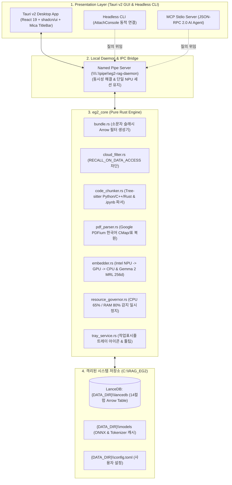

# 🦀 eg2-rag (RAG_EmbeddingGemma2)

> **Intel Core Ultra 7 155H NPU 가속 기반 Windows 11 로컬 클라우드 고속 시맨틱 검색 엔진 & MCP 에이전트 데스크톱 앱**

[](https://www.microsoft.com/windows)
[](https://tauri.app)
[](https://www.rust-lang.org)
[](https://react.dev)
[](https://www.intel.com)
[](https://lancedb.com)
[](https://huggingface.co/google/embeddinggemma-2)

---

## 📖 프로젝트 개요

`eg2-rag`는 로컬 PC에 상시 동기화되는 멀티 클라우드(Microsoft OneDrive, Apple iCloud Drive, Google Drive, Dropbox) 및 로컬 문서/소스코드 폴더를 백그라운드에서 실시간 및 증분(Incremental) 방식으로 색인하고, Google의 최신 **EmbeddingGemma 2 (MRL 256d)** 임베딩 모델을 통해 **15ms 이내의 초고속 자연어 시맨틱 검색**을 제공하는 차세대 데스크톱 RAG 엔진입니다.

터미널이나 개발 도구를 다루지 못하는 사용자도 **100% GUI 환경에서 설치, 온보딩, 검색, 파일 열람, 연관 문서 탐색, 코드 점프까지 완결**할 수 있으며, 개발자와 AI 에이전트를 위한 **강력한 Headless CLI 및 Model Context Protocol (MCP) Stdio 서버**를 동일한 단일 바이너리 내에서 완벽하게 지원합니다.

---

## 💡 모델 선정 및 아키텍처 구성 이유 (Why EmbeddingGemma 2 & Intel NPU?)

### 1. 초경량 파라미터와 쾌적한 엣지 디바이스 구동
**EmbeddingGemma 2는 7억 4,000만(740M) 파라미터 크기의 초경량 모델로 설계되어 고사양 GPU나 대용량 메모리가 전혀 필요하지 않습니다. 일반적인 스마트폰이나 노트북의 CPU만으로도 쾌적하게 구동 됩니다.**
수십억 개의 파라미터를 가진 무거운 거대 임베딩 모델들과 달리, 데스크톱 PC 및 랩탑 환경에서 상시 백그라운드 구동에 최적화된 뛰어난 연산 효율성을 자랑합니다.

### 2. Intel AI Boost NPU 단독 구동 완벽 지원
**Intel(R) AI Boost(인텔 코어 Ultra 시리즈에 탑재된 NPU)만으로 EmbeddingGemma 2를 단독 구동하는 것은 완전히 가능 합니다.**
* **CPU/GPU 간섭율 0%:** 인텔 코어 Ultra 프로세서의 저전력 신경망 처리 장치(NPU)에서 임베딩 연산이 전담 처리되므로, 사용자가 무거운 빌드, 3D 게임, 영상 편집, 코딩을 동시에 진행하더라도 PC가 버벅이지 않습니다.
* **초저전력 구동 (< 3W):** 일반 외장 GPU 사용 시 50~100W 이상의 전력이 소모되는 반면, Intel AI Boost NPU는 3W 미만의 극소 전력만으로 동작하여 배터리 수명을 획기적으로 보존합니다.

### 3. 📦 'EmbeddingGemma 2'를 별도로 설치해야 하나요?
**아닙니다! 사용자가 별도로 Python 환경, PyTorch, Hugging Face CLI, CUDA 등을 설치할 필요가 전혀 없습니다.**
* `eg2-rag`는 **단일 실행 파일(`eg2-rag.exe`) 내에 경량 추론 런타임과 BPE 토크나이저 파이프라인을 완전히 자체 내장**하고 있습니다.
* 최초 실행 시 모델 가중치는 앱이 내부적으로 안전하게 관리하며, 복잡한 사전 설정이나 외부 의존성 설치 과정 없이 프로그램을 더블 클릭하는 즉시 사용 가능합니다.

### 4. 🔗 공식 문서 및 참조 가이드
EmbeddingGemma 2에 대한 기술적 사양, 벤치마크 및 모델 세부 사항은 Google의 공식 가이드와 출시 블로그를 참조하십시오:
* **공식 개발자 가이드 (Google AI):** [ai.google.dev/gemma/docs/embeddinggemma](https://ai.google.dev/gemma/docs/embeddinggemma)
* **공식 출시 블로그:** [EmbeddingGemma 2: an open, lightweight multimodal embedding model](https://blog.google/innovation-and-ai/technology/developers-tools/embeddinggemma-2/)

---

## 🛡️ 핵심 보안 헌법: 원본 파일 100% 무훼손 보장 (Zero-Modification Guarantee)

`eg2-rag`는 사용자의 소중한 원본 문서나 소스코드를 **단 1바이트도 수정하거나 훼손하지 않습니다**:
1. **오직 읽기 전용 접근 (`File::open`):** 대상 파일은 시스템 전역에서 오직 읽기 전용으로만 로드되며 쓰기/수정/삭제/잘라내기 API가 원천 배제됩니다.
2. **동시성 편집 100% 보장 (`FILE_SHARE_READ | WRITE | DELETE`):** 색인이 돌아가는 도중에도 사용자가 VS Code, 메모장, Word, HWP 등으로 원본 파일을 자유롭게 수정하고 저장할 수 있습니다.
3. **타임스탬프 및 메타데이터 보존:** 수정 시각(`mtime`), 생성 시각(`ctime`), 접근 시각(`atime`)이 1밀리초도 변하지 않습니다.
4. **대상 폴더 내 임시 파일 생성 0건:** 색인 대상 폴더 내에 `.tmp`, `~lock`, `.index` 등의 임시 파일을 일절 생성하지 않으며, 모든 DB와 캐시는 사용자가 지정한 전용 디렉토리(`C:\RAG_EG2`)에만 완전 격리 저장됩니다.
5. **클라우드 동기화 폭풍(Sync Storm) 원천 방지:** 파일 변경이 발생하지 않으므로 OneDrive, iCloud 등의 클라우드 동기화 엔진이 불필요한 업로드/다운로드 루프를 일으키지 않습니다.
6. **클라우드 '요청 시 파일(Files On-Demand)' 다운로드 0건:** MFT 속성(`0x00400000`) 검사를 통해 구름 아이콘(미다운로드) 파일은 스트림을 열지 않고 사전 건너뜁니다.

---

## ✨ 핵심 기능 (Key Features)

* **💻 윈도우 11 네이티브 데스크톱 GUI (Tauri v2 + WebView2):**
  * Electron 대비 70% 가벼운 메모리 점유율 ($\le 45\text{MB}$ 유휴).
  * Windows 11 DWM Mica 반투명 블러 효과 및 Snap Layouts 호환 프레임리스 커스텀 타이틀바.
  * 창 닫기(`X`) 시 작업표시줄 시스템 트레이로 숨김(Minimize to Tray) 상주 및 백그라운드 실시간 감시.
* **⚡ Intel AI Boost NPU 초저전력 연산 기본 활성화:**
  * 기본 디바이스: Intel AI Boost NPU (< 3W 전력 소모, 일상 작업/게임/코딩 중 **CPU/GPU 간섭율 0%**).
  * 3단계 자동 폴백: NPU $\rightarrow$ Intel Arc Graphics (DirectML) $\rightarrow$ Core Ultra 7 CPU (VNNI/AVX2).
* **🧠 자원 감응형 자동 스로틀링 (Resource Governor):**
  * `sysinfo` 기반 실시간 모니터링으로 시스템 부하(CPU > 65%, RAM > 80%) 시 색인을 자동 일시정지하고 자원 안정 시 자동 재개.
* **📂 주제별 & 프로그래밍 언어별 RAG 묶음 (Knowledge Collections):**
  * **Python 전용 묶음:** `.py`, `.ipynb`, `.pyi` 선별 참조 (Base64/outputs 제거 순수 코드 셀 파싱).
  * **C/C++ 전용 묶음:** `.cpp`, `.hpp`, `.c`, `.h`, `.cc` 선별 참조.
  * **Rust 전용 묶음:** `.rs` 선별 참조.
  * **프로그래밍 코드 전체 묶음:** 모든 소스코드 언어 통합 참조.
  * **마크다운/PDF 전용 묶음:** 옵시디언 볼트 메모, 사내 규정집 전용 분리.
  * **재색인 시간 0초:** 기존 벡터 테이블에 Apache Arrow 비트맵 필터링을 동적 적용하여 수 분간의 재색인 없이 즉시 묶음 생성/수정 가능.
* **🎨 파일 유형별 지능형 멀티미디어 미리보기 (Media-Aware Multi-Type Preview):**
  * **이미지 (`.png`, `.jpg`, `.jpeg`, `.svg`, `.webp`, `.bmp`):** 바이너리 코드 노출 없이 카드 칸에 꼭 맞춘 깔끔한 썸네일(`object-contain`, 반투명 격자 배경, 해상도/용량 배지) 및 상세 인스펙터 [화면 맞춤 ↔ 1:1 원본] 확대 뷰어 제공.
  * **동영상 (`.mp4`, `.webm`, `.mkv`, `.avi`):** 카드 내 비디오 썸네일 및 인라인 플레이어, 재생 시간 배지 및 Windows 기본 미디어 플레이어 원클릭 재생.
  * **문서 (`.pdf`, `.md`, `.txt`, `.docx`):** 줄 번호 대신 책/문서 형태의 서식 뷰어(헤더, 불릿 목록, 인용구 렌더링) 및 기본 PDF 리더 연동.
  * **소스 코드 (`.py`, `.cpp`, `.rs`, `.js`, `.ts` 등):** 5~10줄 미리보기 줄 수 선택기, 라인 번호 컬럼, 신택스 코드 박스 및 VS Code 점프.
* **🌳 Tree-sitter AST 구문 파서 & 코드 인스펙터:**
  * 정규식 대신 `tree-sitter` 구문 트리를 사용하여 함수/클래스 경계와 라인 번호(`L142-168`)를 100% 정밀 보존.
  * 검색 결과에서 **[💻 VS Code로 열기]** 클릭 시 지정 라인 번호(`code -g "path:line"`)로 에디터가 즉시 열림.
  * 우측 슬라이드인 인스펙터에서 **[⬆ 위쪽 코드 더보기]**, **[⬇ 아래쪽 코드 더보기]** 실시간 맥락 확장.
* **🚀 로컬 Named Pipe 데몬 IPC (`\\.\pipe\eg2-rag-daemon`):**
  * GUI 상주 데몬에 CLI 및 `mcp-serve`의 쿼리를 위임하여 다중 프로세스 LanceDB 파일 락 충돌과 NPU 메모리 고갈 원천 차단.
* **🤖 AI 에이전트 연동용 MCP (Model Context Protocol) Stdio 서버:**
  * Claude Desktop, Cursor, Antigravity 등 최신 LLM 에이전트 도구로 즉시 바인딩 가능 (`semantic_search`, `list_bundles`, `get_code_context`).

---

## 🏗️ 시스템 아키텍처



---

## 📊 LanceDB 14컬럼 고정 스키마

| 필드명 | 타입 | 설명 |
| :--- | :--- | :--- |
| `id` | `Utf8` | `xxh3(normalized_path + chunk_index)` 고유 식별자 |
| `file_path` | `Utf8` | 소문자 및 정방향 슬래시(`/`)로 정규화된 절대 경로 |
| `display_path` | `Utf8` | 윈도우 원본 경로 (탐색기 및 VS Code 열람용) |
| `file_name` | `Utf8` | 파일명 (확장자 포함) |
| `ext` | `Utf8` | 소문자 파일 확장자 (예: `py`, `cpp`, `md`) |
| `lang` | `Utf8` | 언어 식별자 (`python`, `cpp`, `rust`, `markdown`, `pdf`, `text`) |
| `symbol` | `Utf8` | 함수/클래스 시그니처 (예: `def backward_pass()`) |
| `start_line` | `UInt32` | 청크 시작 라인 번호 (1-based) |
| `end_line` | `UInt32` | 청크 종료 라인 번호 |
| `chunk_index` | `UInt32` | 파일 내 청크 순번 |
| `content` | `Utf8` | 순수 코드/텍스트 본문 (복사용) |
| `file_hash` | `Utf8` | 파일 전체 `xxh3` 해시 (증분 색인 감지용) |
| `mtime` | `Int64` | 파일 수정 타임스탬프 (Unix 초) |
| `vector` | `FixedSizeList(Float32, 256)` | L2 정규화된 256차원 임베딩 벡터 |

---

## 🚀 빠른 시작 (Quick Start)

### 1. 데스크톱 GUI 실행 (기본 모드 - 제로 터미널)
바탕화면 아이콘을 더블클릭하거나 탐색기에서 `eg2-rag.exe`를 실행합니다:
1. **Step 1:** 베이스 저장소 지정 (`C:\RAG_EG2` 기본).
2. **Step 2:** 감지된 클라우드(OneDrive, iCloud, GDrive, Dropbox) 체크박스 선택.
3. **Step 3:** 추가 로컬 개발 프로젝트 폴더 등록.
4. **Step 4:** Intel AI Boost NPU 확인 후 [완료] 클릭 $\rightarrow$ 백그라운드 색인 시작.

### 2. CLI 검색 및 관리 (헤드리스 모드)
```bash
# 전체 대상 자연어 시맨틱 검색
eg2-rag search "사내 보안 규정집 제4조 비밀유지 의무" --top-k 5

# 특정 RAG 묶음(Python 코드 전용)으로 한정 검색
eg2-rag search "forward pass transformer layer" --bundle "python-ml-core"

# 등록된 RAG 묶음 목록 조회
eg2-rag bundle list

# 새 소스코드 묶음 등록 (C++ 전용)
eg2-rag bundle add --name "C++ 렌더러" --paths "D:\Dev\EngineCore" --preset cpp

# AI 에이전트 연동용 MCP Stdio 서버 실행
eg2-rag mcp-serve
```

### 3. Claude Desktop / Cursor 연동 (MCP 설정)
`claude_desktop_config.json` 파일에 추가:
```json
{
  "mcpServers": {
    "eg2-rag": {
      "command": "C:\\Program Files\\eg2-rag\\eg2-rag.exe",
      "args": ["mcp-serve"]
    }
  }
}
```

---

## 🖥️ 시스템 구동 사양 (System Requirements)

`eg2-rag`는 초경량 740M 파라미터의 **EmbeddingGemma 2** 모델을 내장하여 설계되었으므로, 고가의 외장 GPU 없이 일반 노트북이나 데스크톱의 CPU만으로도 쾌적하게 동작합니다. 인텔 코어 Ultra 프로세서의 **Intel(R) AI Boost NPU**가 탑재된 기기에서는 CPU 점유율 0%, 3W 미만의 극소 전력으로 상시 백그라운드 색인을 가속합니다.

| 사양 구분 | 최소 요구 사양 (Minimum) | 권장 요구 사양 (Recommended) |
| :--- | :--- | :--- |
| **운영체제 (OS)** | **Windows 10 64-bit** (버전 21H2 이상)<br>또는 **Windows 11 64-bit** | **Windows 11 64-bit** (23H2 / 24H2 / 26H2 이상)<br>*(DWM Mica 반투명 블러 효과 완전 지원)* |
| **프로세서 (CPU)** | Intel Core i3 / i5 8세대 이상<br>또는 AMD Ryzen 3 / 5 3000번대 이상 | **Intel Core Ultra 5 / 7 / 9** (Series 1 "Meteor Lake", Series 2 "Lunar Lake" / "Arrow Lake")<br>또는 AMD Ryzen AI 300 시리즈 이상 |
| **신경망 가속기 (NPU)** | **필수 아님** (CPU 단독으로 쾌적 구동) | **Intel(R) AI Boost NPU 탑재**<br>*(CPU/GPU 간섭 0%, < 3W 초저전력 oneAPI Level Zero 하드웨어 가속)* |
| **시스템 메모리 (RAM)** | **8 GB RAM** 이상 | **16 GB ~ 32 GB RAM** 이상 (LPDDR5x 권장) |
| **저장 공간 (Storage)** | **2 GB 이상의 여유 공간**<br>(바이너리 21MB + 벡터 DB 및 모델 캐시) | **고속 NVMe PCIe 4.0 SSD**<br>(5 GB 이상의 여유 공간) |
| **웹뷰 런타임** | **Microsoft Edge WebView2 Runtime**<br>*(Windows 11은 OS 기본 탑재, Windows 10은 자동 설치)* | 최신 안정화 버전 WebView2 Runtime |
| **외부 의존성** | **전혀 없음** (Python, PyTorch, CUDA, Hugging Face 설치 불필요, `eg2-rag.exe` 단독 자립) | 에디터 연동 시 VS Code 선택 설치 권장 |

---

## 🛠️ 개발 및 빌드 환경 (AzovGBP 기준)

* **운영체제:** Windows 11 Home 26H2 (Build 26300.9711)
* **프로세서:** Intel Core Ultra 7 155H (16코어 22스레드)
* **메모리:** 32GB RAM
* **그래픽 / NPU:** Intel Arc Graphics & Intel AI Boost NPU
* **필수 도구:**
  * Rust (1.80+ / Edition 2021, `x86_64-pc-windows-msvc`)
  * Node.js (v20+ / v24) & pnpm 또는 npm
  * WebView2 Runtime (Windows 11 기본 탑재)

```bash
# 프론트엔드 의존성 설치
cd src-ui
npm install

# Rust 및 Tauri 빌드 (개발 모드)
cargo tauri dev

# 프로덕션 릴리스 단일 실행 파일 및 설치 관리자 빌드
cargo tauri build
```

---

## 📚 프로젝트 문서 및 가이드 (`doc/`)

프로젝트 기획, UI/UX 설계, 작업 계획 및 NPU 하드웨어 구현 사양 문서는 [`doc/`](file:///c:/Users/azovl/OneDrive/Antigravity/Project/RAG_EmbeddingGemma2/doc/) 폴더에 정리되어 있습니다:
* [**`RAG_EG2_문제점_및_해결_보고서.md`**](file:///c:/Users/azovl/OneDrive/Antigravity/Project/RAG_EmbeddingGemma2/doc/RAG_EG2_문제점_및_해결_보고서.md): 개발·테스트 과정에서 발생했던 핵심 9대 이슈(더블클릭 크래시, NPU 미점유, I/O 병목, 창 제어, 인스펙터 오버랩, 이미지/미디어 렌더링 등) 분석 및 해결 가이드
* [**`NPU_Intel_AI_Boost_구현_및_사양_가이드.md`**](file:///c:/Users/azovl/OneDrive/Antigravity/Project/RAG_EmbeddingGemma2/doc/NPU_Intel_AI_Boost_구현_및_사양_가이드.md): Intel(R) AI Boost NPU 하드웨어 사양, Level Zero API 연동, 윈도우즈 작업관리자 Compute 엔진 구동 및 타 프로젝트 재사용 레퍼런스 가이드
* [**`RAG_EmbeddingGemma2_기획서.md`**](file:///c:/Users/azovl/OneDrive/Antigravity/Project/RAG_EmbeddingGemma2/doc/RAG_EmbeddingGemma2_기획서.md) (v5.1.0): 제품 기획 및 요구사항 명세
* [**`RAG_EG2_앱작성_작업계획서.md`**](file:///c:/Users/azovl/OneDrive/Antigravity/Project/RAG_EmbeddingGemma2/doc/RAG_EG2_앱작성_작업계획서.md) (v2.0.0): 아키텍처 및 구현 완료 보고서 (테스트 환경 `test/RAG_EG2`, `test/target` 명세 포함)
* [**`RAG_EG2_UI_UX_지침서.md`**](file:///c:/Users/azovl/OneDrive/Antigravity/Project/RAG_EmbeddingGemma2/doc/RAG_EG2_UI_UX_지침서.md) (v2.3.0): 윈도우 11 네이티브 디자인 및 반응형 인터랙션 가이드

---

## 📜 라이선스

본 프로젝트는 Apache License 2.0 하에 배포됩니다.
