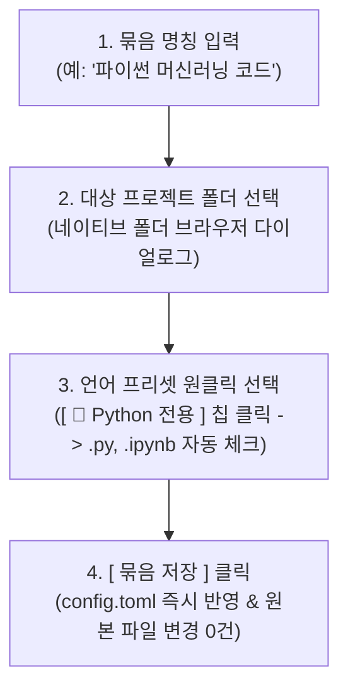
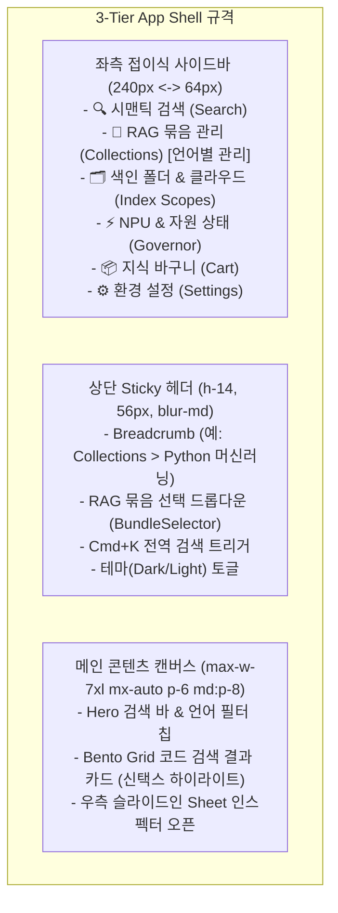

# 🎨 [UI/UX SPEC] eg2-rag: 네이티브 데스크톱 GUI 환경 및 시맨틱 지식 인스펙터 설계 지침서

* **문서명:** `RAG_EG2_UI_UX_지침서.md`
* **버전:** v2.3.0 (색인 대상 원본 파일 절대 무훼손(Zero-Modification) 보장 UI/UX 사양 반영)
* **작성 일자:** 2026-10-26
* **기반 플랫폼:** Windows 11 Home 26H2 (Mica/Acrylic DWM 효과 및 Snap Layouts 지원)
* **데스크톱 앱 프레임워크:** **Tauri v2 + WebView2** (경량 고성능 네이티브 윈도우 앱)
* **프론트엔드 UI 스택:** React 19 + TypeScript + Tailwind CSS + `shadcn/ui` + `framer-motion` + `lucide-react`
* **최우선 준수 기준:** `antigravity_ui_ux_architecture_rules.md` (단일 진실 공급원 - Single Source of Truth)
* **핵심 원칙:**
  1. **"모든 설치 및 설정, 프로그래밍 언어별 소스코드 RAG 묶음 분류, 코드 검색 및 에디터 열람은 터미널 없이 100% GUI만으로 완결 가능해야 한다."**
  2. **"사용자의 원본 파일은 절대 훼손되지 않으며, 오직 읽기 전용으로 안전하게 참조된다."**

---

## 1. 핵심 가치 및 사용자 경험(UX) 흐름

### 1.1. 본 도구의 5대 핵심 가치
1. **원본 파일 100% 무훼손 안전 보장 (Zero-Modification & Read-Only Safety):** 색인 대상 원본 파일(OneDrive, iCloud, 로컬 코드 등)의 내용, 속성, 타임스탬프를 절대 수정하지 않으며, 임시 파일을 대상 폴더에 일절 생성하지 않는 완전 공유 읽기 모드 제공.
2. **프로그래밍 언어별 소스코드 선별 RAG (Code-Specific Collections):** Python(`.py`, `.ipynb`), C/C++(`.cpp`, `.hpp`, `.c`, `.h`), Rust(`.rs`) 또는 전체 프로그래밍 코드를 선별하여 "파이썬 머신러닝 코드", "C++ 네이티브 엔진" 등 언어별 전용 RAG 묶음 구성.
3. **초고속 시맨틱 검색 (Semantic Retrieval):** 단순 키워드 매칭을 넘어 사용자의 질문/의도를 파악하여 관련성 높은 문서 및 코드 청크를 15ms 내에 도출.
4. **코드 구문 강조 및 문맥 확인 (Syntax Highlighting & Inspect):** 검색 결과 카드와 슬라이드인 인스펙터에서 언어별 신택스 하이라이팅, 함수/클래스 심볼, 라인 번호를 즉시 확인하고 필요한 코드를 스크랩.
5. **원클릭 IDE/탐색기 연동 (Open in VS Code & Explorer):** 검색된 코드의 정확한 라인 위치로 VS Code(`code -g "path:line"`)나 윈도우 탐색기를 즉시 실행.

### 1.2. 5단계 UX 워크플로우


---

## 2. 윈도우 11 네이티브 데스크톱 윈도우 규격 (Desktop Window Spec)

### 2.1. 프레임리스(Frameless) 커스텀 타이틀바 (`TitleBar.tsx`)
Windows 11의 모던 디자인 언어를 수용하고 상단 헤더와 자연스럽게 결합되는 커스텀 타이틀바를 구현합니다:

* **배경 효과:** Windows 11 DWM Mica / Acrylic 반투명 블러 효과 (`bg-background/80 backdrop-blur-md`).
* **높이:** `h-9` (36px, 창 컨트롤 영역 포함).
* **드래그 영역:** 좌측 및 중앙 빈 공간에 `data-tauri-drag-region` 속성을 부여하여 마우스 드래그로 창 이동 가능.
* **좌측 브랜드 & 상태 인디케이터:**
  * `eg2-rag` 미니 로고 + 🟢 **NPU 가속 활성** 상태 점(Dot).
  * 🛡️ **"원본 무훼손 읽기전용 보호" 안전 뱃지:**
    * 마우스 호버 시 툴팁: `"색인 대상 원본 파일 100% 무훼손 읽기 전용 보호 중 (타 프로그램 동시 편집 완전 허용, 임시 파일 미생성)"`
* **우측 윈도우 컨트롤러 (Windows 11 Snap Layouts 호환):**
  * `_` **최소화:** 트레이 또는 작업표시줄로 최소화.
  * `□` **최대화/복원:** Windows 11 네이티브 Snap Layouts 팝업을 지원하는 최대화 버튼.
  * `✕` **닫기:** 창을 완전히 끄는 대신 **작업표시줄 시스템 트레이로 숨김(Minimize to Tray)** 처리되어 백그라운드 실시간 동기화 유지.

---

## 3. 주제별 RAG 묶음 및 프로그래밍 코드 선별 UI/UX 사양

### 3.1. RAG 묶음 선택기 (`BundleSelector.tsx` - 언어 뱃지 일체형)
Hero 검색창 좌측에 일체형 드롭다운 컴포넌트(`shadcn/ui Select`)로 배치되어 사용자가 질문을 던질 대상 지식 풀을 즉시 전환합니다:

```text
┌────────────────────────────────────────────────────────────────────────────────────────┐
│ [ 🐍 파이썬 머신러닝 코드 (Python 전용) ▾ ] [ 🔍 역전파 손실 계산 함수 검색...          ]│
├────────────────────────────────────────────────────────────────────────────────────────┤
│  🌐 전체 지식 베이스 (All Documents)                                                   │
│  🐍 파이썬 머신러닝 코드 [Project\AI | *.py, *.ipynb]                                   │
│  ⚙️ C/C++ 네이티브 엔진 [Dev\EngineCore | *.cpp, *.hpp, *.c, *.h]                       │
│  🦀 Rust 시스템 백엔드 [Dev\RAG_Engine | *.rs]                                          │
│  💻 개발 프로젝트 전체 소스코드 [DevProjects | Code All]                                │
│  📝 개인 옵시디언 지식 베이스 [OneDrive\ObsidianVault | *.md]                           │
│  🏢 사내 보안 및 취업 규정집 [OneDrive\문서\보안 | *.pdf]                               │
│ ────────────────────────────────────────────────────────────────────────────────────── │
│  ➕ 새로운 RAG 묶음 만들기... (언어 프리셋 모달 호출)                                    │
└────────────────────────────────────────────────────────────────────────────────────────┘
```

* **선택 시 시각적 피드백:**
  * 검색창 입력 플레이스홀더 동적 변경: `"선택된 Python 코드베이스 내 함수, 클래스, 알고리즘 검색..."`
  * 드롭다운 우측에 언어 전용 컬러 뱃지 노출 (`Python: text-blue-500`, `C++: text-cyan-500`, `Rust: text-amber-500`).

---

### 3.2. 새 RAG 묶음 생성 모달 (`BundleModal.tsx` - 언어별 프리셋 원클릭 지원)
마우스 클릭 한 번으로 Python, C++, Rust 등 원하는 언어 확장자들을 손쉽게 묶을 수 있는 프리셋 칩 UI를 제공합니다:



* **언어별 원클릭 프리셋 칩 (Preset Chips):**
  * `[ 🐍 Python 전용 ]` $\rightarrow$ `extensions: ["py", "ipynb", "pyi"]` 자동 선택.
  * `[ ⚙️ C/C++ 전용 ]` $\rightarrow$ `extensions: ["cpp", "hpp", "c", "h", "cc", "cxx"]` 자동 선택.
  * `[ 🦀 Rust 전용 ]` $\rightarrow$ `extensions: ["rs"]` 자동 선택.
  * `[ 💻 프로그래밍 코드 전체 ]` $\rightarrow$ `extensions: ["py", "ipynb", "cpp", "hpp", "c", "h", "rs", "ts", "js", "go", "java"]` 자동 선택.
  * `[ 📝 마크다운 메모 ]` $\rightarrow$ `extensions: ["md"]` 자동 선택.
  * `[ 📄 PDF 문서 ]` $\rightarrow$ `extensions: ["pdf"]` 자동 선택.
  * `[ ✏️ 직접 입력 (Custom) ]` $\rightarrow$ 쉼표로 임의 확장자 입력 가능.

---

### 3.3. 소스코드 특화 Bento Grid 결과 카드 (`ResultCard.tsx`)
프로그래밍 소스코드가 검색되었을 때, 일반 텍스트 카드와 차별화된 **신택스 하이라이팅 코드 블록 카드**로 렌더링됩니다:

```text
┌──────────────────────────────────────────────────────────────────────────────┐
│ [🐍 model_trainer.py]  [Func: def backward_pass()]  [🟢 95.1%] [언어: Python] │
│ C:\Projects\AI\models\model_trainer.py:L142-168  │
├──────────────────────────────────────────────────────────────────────────────┤
│ 142 │ def backward_pass(self, loss: torch.Tensor, optimizer: Optimizer):     │
│ 143 │     """역전파 경사도 계산 및 NPU 가속 그래디언트 클리핑 수행"""         │
│ 144 │     optimizer.zero_grad(set_to_none=True)                              │
│ 145 │     loss.backward()                                                    │
│ 146 │     torch.nn.utils.clip_grad_norm_(self.model.parameters(), max_norm=1.0)│
├──────────────────────────────────────────────────────────────────────────────┤
│ [🔍 원문 인스펙터]  [💻 VS Code로 열기]  [📋 코드 복사]  [📂 파일 위치 열기] │
└──────────────────────────────────────────────────────────────────────────────┘
```

* **원클릭 액션 버튼 구성:**
  1. 💻 **[VS Code로 열기]:** `code -g "path:142"`를 비동기 실행하여 VS Code에서 정확한 라인 번호로 즉시 점프.
  2. 📋 **[코드 복사]:** 함수 블록 클립보드 복사 (`Check` 녹색 피드백).
  3. 📂 **[파일 위치 열기]:** 윈도우 탐색기에서 파일 선택 포커스 실행.
  4. ⭐ **[바구니에 담기]:** 프롬프트 질의용 지식 바구니에 첨부.

---

### 3.4. 우측 슬라이드인 코드 인스펙터 (`Sheet` Drawer)
결과 카드를 클릭하면 우측에서 슬라이드 인 되는 드로어(`Sheet`)가 열리며, 전체 코드 파일의 맥락을 확인합니다:

* **상단 헤더 정보:** 파일명, 전체 라인 수, 해당 함수의 상위 클래스 및 시그니처.
* **코드 뷰어:**
  * 다크 모드 기반의 부드러운 신택스 하이라이팅(Syntax Highlighting).
  * 검색된 라인 영역으로 자동 스크롤 및 하이라이트 띠(`bg-primary/10 border-l-2 border-primary`) 표시.
  * **[⬆ 위쪽 코드 더보기]**, **[⬇ 아래쪽 코드 더보기]** 버튼으로 파일 전체 맥락 열람 (원본 파일은 읽기 전용으로 안전하게 조회).
* **연관된 비슷한 코드 (Similar Code Files):**
  * 동일한 프로젝트 내에서 유사한 패턴이나 함수를 사용하는 다른 소스코드 파일 5개를 하단에 추천.

---

## 4. 메인 화면 레이아웃 (Strict 3-Tier App Shell)

`antigravity_ui_ux_architecture_rules.md`를 100% 준수하여 정보의 분산 없는 일관된 3계층 구조를 확립합니다.



---

## 5. 온보딩 마법사 내 안전 보장 배너 (`WizardModal.tsx`)

사용자가 최초 환경 설정 시 안심하고 사용할 수 있도록 마법사 하단에 **"원본 파일 100% 무훼손 안전 보장 배너"**를 명확히 렌더링합니다:

```text
┌──────────────────────────────────────────────────────────────────────────────┐
│ 🛡️ eg2-rag 무훼손 안전 보장 원칙 (Non-Destructive Invariant)                  │
│ • 색인 대상 원본 파일은 오직 읽기 전용(Shared Read-Only)으로만 안전하게 참조됩니다. │
│ • 파일 내용 수정, 삭제, 타임스탬프 변경 또는 임시 파일 생성이 일절 발생하지 않습니다.│
│ • 색인 진행 중에도 타 프로그램(VS Code, Word, 메모장 등)에서 자유롭게 편집 가능합니다.│
└──────────────────────────────────────────────────────────────────────────────┘
```

---

## 6. 프론트엔드 검증 체크리스트 (Verification Checklist)

* [ ] **원본 무훼손 확인:** 색인 및 검색 진행 중/후 대상 원본 파일의 내용 및 수정 시각(`mtime`)이 100% 보존되는가?
* [ ] **타이틀바 안전 뱃지:** 타이틀바에 🛡️ 무훼손 안전 뱃지가 정상 노출되고 호버 시 상세 툴팁이 뜨는가?
* [ ] **언어별 프리셋 생성:** `BundleModal`에서 `[ 🐍 Python 전용 ]` 또는 `[ ⚙️ C/C++ 전용 ]` 프리셋 클릭 시 관련 확장자만 정확히 선택되어 묶음이 생성되는가?
* [ ] **코드 검색 정밀도:** Python 묶음 선택 시 C++이나 마크다운이 배제되고 오직 Python 함수/클래스 청크만 결과에 도출되는가?
* [ ] **VS Code 직접 연동:** 검색 결과에서 [💻 VS Code로 열기] 클릭 시 해당 파일의 해당 라인 번호로 에디터가 즉시 열리는가?
* [ ] **코드 신택스 하이라이팅:** 코드 카드 및 우측 인스펙터에서 Python, C++, Rust 언어 문법이 선명하게 구문 강조되어 표시되는가?
* [ ] **재색인 없는 즉시성:** 새로운 언어 묶음을 추가하거나 수정했을 때 대기 시간 없이 즉시 검색에 반영되는가?
* [ ] **GUI 단독 자립성:** 온보딩부터 언어별 묶음 생성, 소스코드 검색, VS Code/탐색기 열기까지 터미널 0회로 완결되는가?
* [ ] **CLI 및 에이전트 연동:** 터미널 `eg2-rag search "..." --bundle "python-ml-core"` 또는 MCP 도구 호출 시 동일한 코드 필터링이 정상 작동하는가?