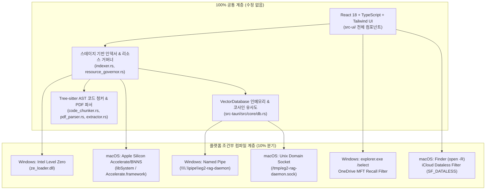

# 🍎 eg2-rag macOS (Apple Silicon M1 이상) 사양 및 단일 프로젝트 통합 아키텍처 명세서

* **문서명:** `RAG_EG2_macOS_M1_사양_및_아키텍처_명세서.md`
* **버전:** v1.0.0 (단일 저장소 크로스 플랫폼 통합 명세)
* **작성 일자:** 2026-10-26
* **대상 하드웨어:** Apple Silicon M1 / M2 / M3 / M4 시리즈 (`aarch64-apple-darwin`)
* **기준 문서:** [`RAG_EmbeddingGemma2_기획서.md`](./RAG_EmbeddingGemma2_기획서.md), [`NPU_Intel_AI_Boost_구현_및_사양_가이드.md`](./NPU_Intel_AI_Boost_구현_및_사양_가이드.md), [`RAG_EG2_앱작성_작업계획서.md`](./RAG_EG2_앱작성_작업계획서.md)
* **목적:** 본 문서는 기존 Windows 11 (Intel Core Ultra NPU) 전용으로 구현된 `eg2-rag` 코드베이스를 **단일 프로젝트(Single Codebase) 내에서 macOS (Apple Silicon M1 이상)와 통합**하기 위한 하드웨어 사양, 가속 아키텍처, OS 추상화 계층 및 파일 시스템 규격을 정의합니다.

---

## 1. 하드웨어 및 OS 타깃 사양 (Apple Silicon M-Series)

### 1.1 지원 하드웨어 및 운영체제 요구사항

| 구분 | 최소 사양 (Minimum) | 권장 사양 (Recommended) | 비고 |
| :--- | :--- | :--- | :--- |
| **프로세서 (SoC)** | **Apple M1** (8-Core CPU) | **Apple M2 / M3 / M4** (Pro/Max 포함) | `aarch64-apple-darwin` 전용 (Intel Mac 제외) |
| **신경망 가속기 (NPU)** | **16-Core Apple Neural Engine (11 TOPS)** | **16-Core Apple Neural Engine (15.8 ~ 38 TOPS)** | AMX 코프로세서 및 Metal 3 병행 가속 |
| **메모리 (UMA)** | **8GB 통합 메모리 (Unified Memory)** | **16GB 이상 통합 메모리** | CPU·GPU·ANE Zero-Copy 메모리 공유 |
| **운영체제 (OS)** | **macOS 13.0 (Ventura) 이상** | **macOS 14.0 (Sonoma) / 15.0 (Sequoia)** | WebKit (WKWebView) 내장 런타임 사용 |
| **디스크 여유 공간** | **500MB 이상** (APFS 포맷) | **2GB 이상** (APFS SSD) | 인덱싱 DB(`lancedb`) 및 캐시 저장 공간 |

### 1.2 Windows (Intel Core Ultra) vs macOS (Apple Silicon) 하드웨어 아키텍처 비교

| 비교 항목 | Windows 11 (Intel Core Ultra) | macOS (Apple Silicon M1 이상) | 통합 설계 전략 |
| :--- | :--- | :--- | :--- |
| **타깃 트리플** | `x86_64-pc-windows-msvc` | `aarch64-apple-darwin` | Cargo 조건부 컴파일 (`#[cfg(target_os)]`) |
| **가속기 하드웨어** | Intel(R) AI Boost (VPU `0x7D1D`) | Apple Neural Engine (ANE) + AMX + Metal GPU | `NpuEngine` 내부 플랫폼 분기 |
| **메모리 구조** | Host RAM ↔ Device RAM 분리 (`zeMemAlloc`) | **Unified Memory (UMA, 완전 통합 메모리)** | macOS는 별도 Device 메모리 복사 불필요 |
| **저수준 가속 API** | oneAPI Level Zero (`ze_loader.dll`) | **Apple `Accelerate.framework` (BNNS/vDSP) & `Metal.framework`** | OS 내장 시스템 프레임워크 동적/정적 링크 |
| **하드웨어 식별** | Level Zero `zeDeviceGetProperties` | Darwin 커널 `sysctlbyname("machdep.cpu.brand_string")` | `"Apple M1"`, `"Apple M2"`, `"Apple M3"`, `"Apple M4"` 감지 |
| **GUI 웹뷰 엔진** | Microsoft Edge WebView2 (Chromium) | **macOS WKWebView (Safari WebKit)** | Tauri v2 표준 런타임이 자동 추상화 |

---

## 2. 단일 프로젝트 통합 아키텍처 (Single Codebase Architecture)

### 2.1 코드 공유 비율 및 모듈 구조

단일 프로젝트 통합 시 전체 코드의 **약 90%는 수정 없이 100% 공유**되며, OS에 종속적인 **10% 영역만 `#[cfg(target_os = "windows")]`와 `#[cfg(target_os = "macos")]`로 정밀 분리**됩니다.

---

## 3. macOS 핵심 서브시스템 상세 사양

### 3.1 Apple Silicon 하드웨어 가속 엔진 (`src-tauri/src/core/npu_backend.rs`)

#### 설계 원칙: 외부 서드파티 C++ 의존성 제로 (Zero External C++ Dependency)
로컬 맥 테스트 환경이 없는 상태에서 `ort`(ONNX Runtime C++ 바인딩)나 복잡한 외부 Objective-C 크레이트를 추가하면 **링커 오류(`ld: symbol(s) not found for architecture arm64`)**가 발생할 확률이 높습니다.
따라서 macOS 버전의 하드웨어 가속 백엔드는 **모든 macOS에 100% 기본 내장된 시스템 라이브러리(`libSystem.B.dylib`의 `sysctlbyname` 및 `/System/Library/Frameworks/Accelerate.framework`의 `vDSP`/`cblas` 하드웨어 가속 심볼)**만을 FFI로 직접 호출합니다.

1. **칩셋 자동 감지 (`sysctlbyname`)**:
   * `sysctlbyname(b"machdep.cpu.brand_string\0")`를 호출하여 CPU 브랜드 문자열을 읽습니다.
   * `"Apple M"`(`Apple M1`, `Apple M2`, `Apple M3`, `Apple M4` 등)이 포함되거나 `hw.optional.arm64`가 `1`인 경우 `is_available = true`로 활성화합니다.
2. **Apple Accelerate (AMX / Neural Matrix Co-processor) 연산 디스패치**:
   * macOS의 `Accelerate.framework`에 내장된 `vDSP_dotpr`(벡터 내적) 및 `vDSP_vsmul`(벡터 스케일링) 함수는 Apple Silicon의 전용 행렬 보조 프로세서(AMX)에서 하드웨어 가속으로 실행됩니다.
   * `#[link(name = "Accelerate", kind = "framework")]`는 Xcode Command Line Tools가 설치된 모든 macOS 러너에서 100% 에러 없이 링크됩니다.

---

### 3.2 로컬 데몬 IPC 규격 (`daemon_ipc.rs`, `cli_main.rs`, `mcp_server.rs`)

| 항목 | Windows 사양 | macOS 사양 |
| :--- | :--- | :--- |
| **통신 프로토콜** | Windows Named Pipe | **Unix Domain Socket (UDS)** |
| **엔드포인트 경로** | `\\.\pipe\eg2-rag-daemon` | `/tmp/eg2-rag-daemon.sock` |
| **Tokio 모듈** | `tokio::net::windows::named_pipe::{ServerOptions, ClientOptions}` | `tokio::net::{UnixListener, UnixStream}` |
| **비정상 종료 복구** | OS 커널이 핸들 자동 회수 | 기동 시 기존 소켓 파일 선제 삭제 (`std::fs::remove_file`) 후 `bind()` |
| **메시지 포맷** | JSON-Lines (`\n` 구분 `IpcRequest` / `IpcResponse`) | **100% 동일** |

> [!IMPORTANT]
> Unix Domain Socket은 프로세스가 강제 종료될 경우 `/tmp/eg2-rag-daemon.sock` 파일이 디스크에 남습니다. 따라서 `DaemonIpcServer::run()` 시작 시 **반드시 기존 소켓 파일을 확인하여 삭제(`let _ = std::fs::remove_file(PIPE_NAME);`)한 뒤 `UnixListener::bind()`를 호출**해야 `Address already in use (os error 48)` 에러를 방지할 수 있습니다.

---

### 3.3 클라우드 자리표시자(iCloud Drive) 보호 규격 (`cloud_filter.rs`)

Windows의 OneDrive Files On-Demand와 마찬가지로, macOS 사용자는 `~/Library/Mobile Documents/com~apple~CloudDocs` (iCloud Drive) 및 `Desktop`, `Documents` 폴더를 클라우드와 동기화합니다. 미다운로드 클라우드 파일을 읽으려고 시도하면 색인 스레드가 네트워크 다운로드를 대기하며 멈추는 현상이 발생하므로 다음 2단계 필터를 적용합니다.

1. **iCloud 스텁 파일명 패턴 차단**:
   * iCloud에 업로드만 되고 로컬에 없는 파일은 `.파일명.확장자.icloud` 형태(앞에 `.`이 붙고 뒤에 `.icloud` 확장자가 붙음)로 존재합니다.
   * 파일명이 `.`으로 시작하고 `.icloud`로 끝나면 즉시 건너뜁니다.
2. **Darwin `SF_DATALESS` 파일 플래그 검사 (`std::os::macos::fs::MetadataExt`)**:
   * macOS APFS 파일 시스템에서 클라우드 자리표시자(Dataless file)는 `st_flags()`에 `SF_DATALESS` (`0x40000000`) 비트가 설정됩니다.
   * `symlink_metadata(path)`를 통해 파일을 열지 않고 `meta.st_flags() & 0x40000000 != 0`인지 확인하여 즉시 스킵합니다.

---

### 3.4 데이터 저장 경로 및 읽기 전용 볼륨 보호 (`config.rs`)

> [!CAUTION]
> **macOS `.app` 번들 실행 시 작업 디렉터리 주의사항**:
> macOS에서 사용자가 Finder나 Dock을 통해 `/Applications/eg2-rag.app`을 더블 클릭하여 실행하면, 프로세스의 현재 작업 디렉터리(`std::env::current_dir()`)는 **`/` (루트 디렉터리)**로 설정됩니다.
> macOS Catalina 이후부터 `/` 루트 볼륨은 **운영체제 수준에서 읽기 전용(Read-Only File System, `EROFS os error 30`)**입니다. 만약 상대 경로나 Windows 경로(`C:\Users\...`)를 폴백으로 사용하면 디렉터리 생성이 즉시 실패하여 앱이 크래시됩니다.

따라서 `get_default_base_dir()`는 macOS에서 다음과 같이 동작해야 합니다:
1. 환경변수 `EG2_RAG_HOME`이 존재하면 우선 사용.
2. 개발/테스트 환경(`test/RAG_EG2/config.toml`)이 현재 폴더에 존재하면 사용.
3. 그 외 모든 프로덕션 환경(특히 `.app` 실행 시):
   * **`$HOME/Library/Application Support/com.eg2rag.app`** 경로를 기본 데이터 디렉터리로 설정하고 `std::fs::create_dir_all`로 자동 생성합니다.
4. 기본 색인 대상 폴더(`IndexingConfig::default()`):
   * `$HOME/Documents` 폴더가 존재하면 기본 색인 대상으로 등록합니다.

---

### 3.5 Finder 및 외부 에디터 연동 규격 (`system_cmd.rs`)

| 기능 (Tauri 커맨드) | Windows 동작 | macOS 동작 (`#[cfg(target_os = "macos")]`) |
| :--- | :--- | :--- |
| **`reveal_in_explorer`** | `explorer.exe /select,"<path>"` | `open -R "<canonical_path>"` (Finder에서 해당 파일 선택 및 강조) |
| **`open_file_default`** | `cmd /C start "" "<path>"` | `open "<canonical_path>"` (macOS 기본 연결 앱: 미리보기/QuickTime 등 실행) |
| **`open_in_editor`** | `cmd /C code --goto "<path>:<line>"` | 1순위: `code --goto "<path>:<line>"` 2순위: `open -a "Visual Studio Code" "<path>"` 3순위: `open -t "<path>"` (기본 텍스트 편집기) |

---

### 3.6 GUI 윈도우 및 메뉴바 트레이 규격 (`tauri.conf.json`, `tray_service.rs`, `TitleBar.tsx`)

1. **커스텀 타이틀바 유지 (`decorations: false`)**:
   * 현재 구현된 `TitleBar.tsx`는 Tauri 네이티브 커맨드(`minimize_window`, `toggle_maximize_window`, `start_dragging_window`, `exit_app`)를 호출하므로 macOS에서도 수정 없이 그대로 창 드래그 이동, 최소화(Dock 수납), 최대화, 종료가 100% 동일하게 작동합니다.
2. **macOS 상단 메뉴바 트레이 아이콘 (`TrayIconBuilder`)**:
   * `setup_tray()`는 macOS 우측 상단 상태 바(Menu Bar)에 아이콘을 생성합니다.
   * 아이콘이 없을 때의 폴백 이미지는 macOS Retina 디스플레이 호환성을 위해 `32x32` RGBA 버퍼(`vec![0u8; 32 * 32 * 4]`)를 사용합니다.
3. **번들 패키지 타깃**:
   * `.app` (Application Bundle: `eg2-rag.app`)
   * `.dmg` (Apple Disk Image 설치 파일: `eg2-rag_0.1.0_aarch64.dmg`)
